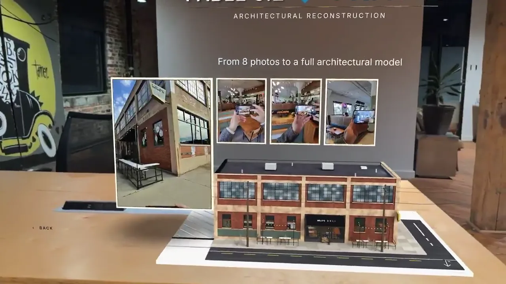
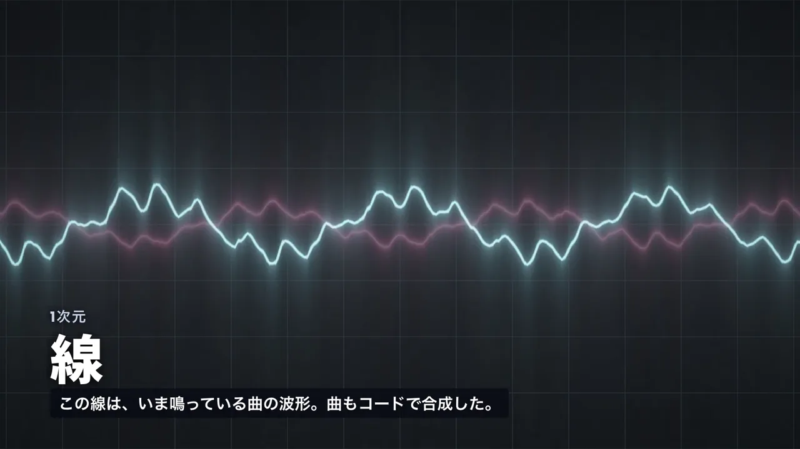
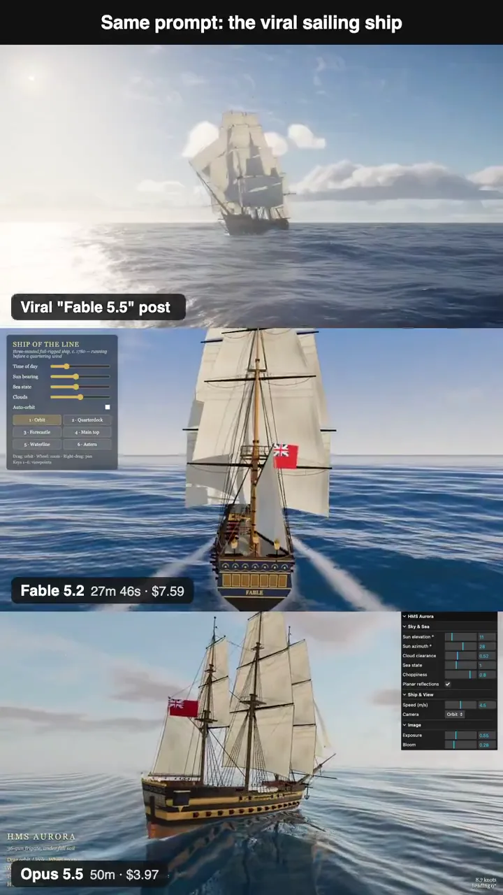
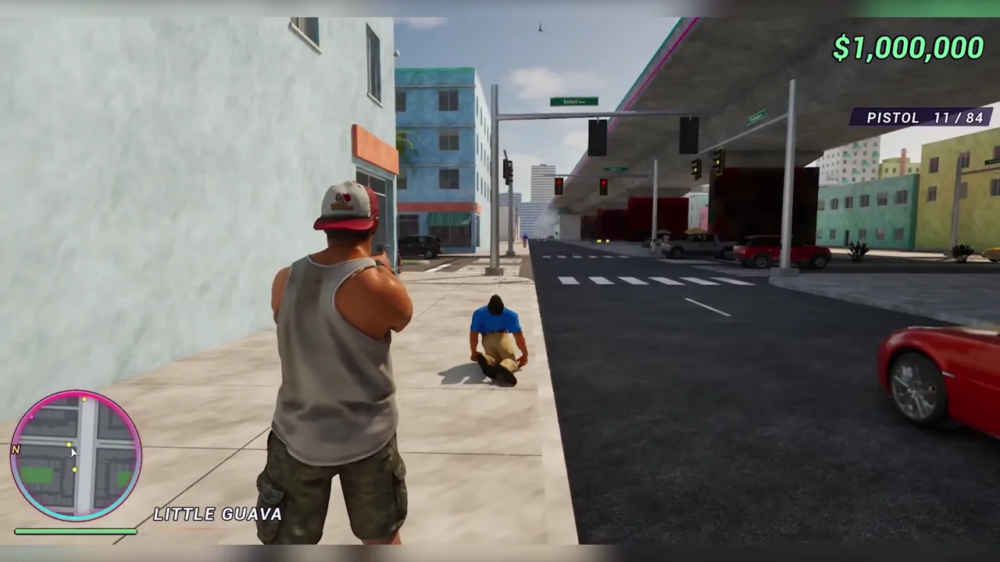
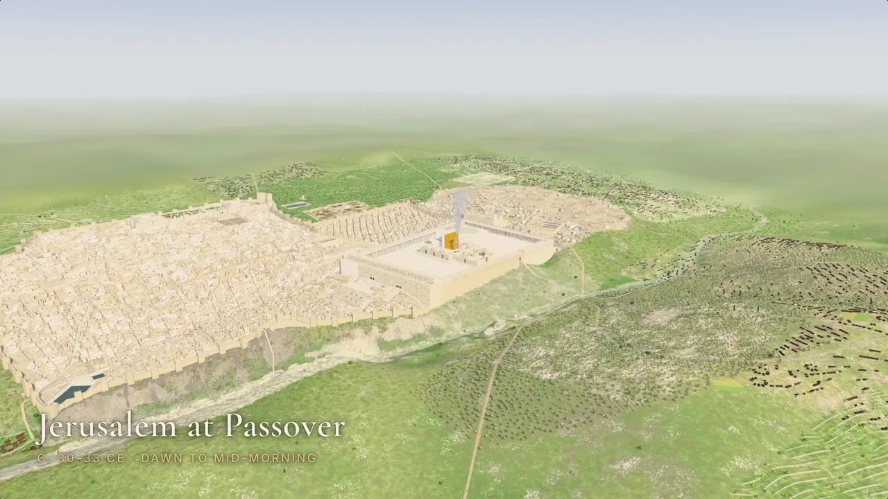
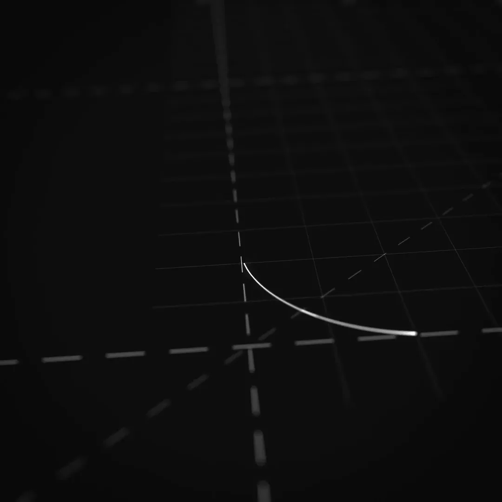
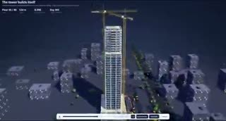
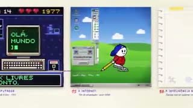
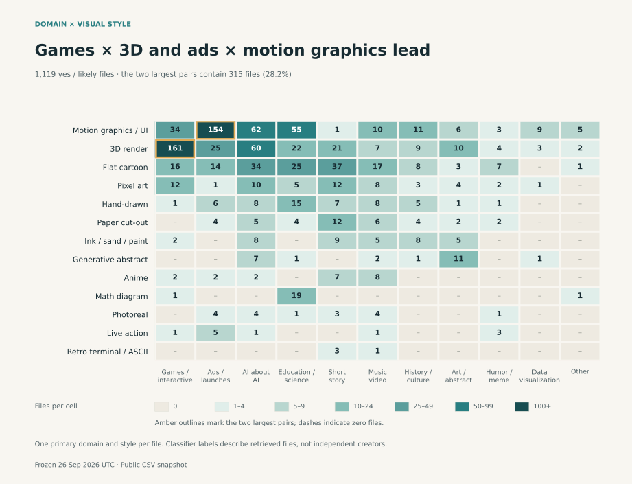
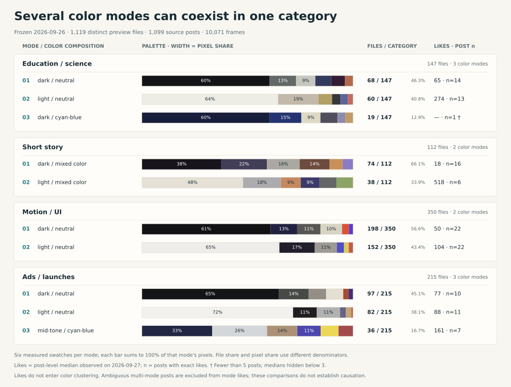

# Awesome Claude Videos 

[中文](README.zh-CN.md) · [Complete directory](docs/library.md) · [Fable 5.2 Report](docs/fable-5-2.md) · [All documentation](docs/README.md)

**More than a link dump — a field guide to making videos with Claude.**
Tracking **597 verified X source posts** from the September 2026 Opus 5.5 wave through the **November 9 launch of [Claude Fable 5.2](https://www.anthropic.com/claude/fable)** — spanning Blender, Three.js, Remotion, AR reconstruction, code-synthesized audio, and interactive games, complete with side-by-side cost benchmarks, published prompts, and an empirical study of 1,119 files.

**[Fable 5.2 Showcase](#fable-52-showcase) · [Model Selection Guide](#model-selection-guide) · [Browse by Model](#browse-the-work) · [Empirical Findings](#research-findings) · [Make Your Own](#make-your-own)**

---

## Fable 5.2 Showcase (Updated 2026-11-16)

Anthropic launched **[Claude Fable 5.2](https://www.anthropic.com/claude/fable)** on **November 9, 2026** ($8 / $40 per M tokens). This update adds **173 creator-reported Fable 5.2 works** (median duration 30s, max 10m 15s), showing a clear leap in 3D/AR reconstruction, code-synthesized audio, and zero-error first-pass reliability.

<table>
<tr>
<td width="33%" valign="top">
 
<b><a href="https://x.com/Trace_AR/status/2121284000232714559">Lunch spot rebuilt from 8 photos as 3D & AR</a></b> 
@Trace_AR · 1:08 · 3D / AR 
Turned 8 photos of a cafe into a full 3D building model and AR walkthrough in hours.
</td>
<td width="33%" valign="top">
 
<b><a href="https://x.com/tankazunori0914/status/2120012834461646927">From a point to a world: shader + synth song</a></b> 
@tankazunori0914 · 1:04 · Prompt included 
Zero external media assets — both visual shaders and synthesized music generated in code.
</td>
<td width="33%" valign="top">
 
<b><a href="https://x.com/leohuanfang/status/2120024307573137874">Sailing ship rerun: Fable 5.2 vs Opus 5.5</a></b> 
@leohuanfang · Comparison · 27m46s / $7.59 
Fable 5.2 opened with zero errors on the first pass; Opus 5.5 needed 3 tries and 50 minutes.
</td>
</tr>
<tr>
<td width="33%" valign="top">
 
<b><a href="https://x.com/ericmaskfr/status/2119910195325481026">Open-world Miami driving & mission game</a></b> 
@ericmaskfr · 2:15 · Prompt included 
Playable 3D city with car paint shops and timed races, complete with published prompt.
</td>
<td width="33%" valign="top">
 
<b><a href="https://x.com/kplikethebird/status/2119900775727902732">Jerusalem at Passover: 3D fly-through</a></b> 
@kplikethebird · 0:30 · Prompt included 
Continuous 3D architectural camera flight from the Temple to the Stepped Street.
</td>
<td width="33%" valign="top">
 
<b><a href="https://x.com/hello_amani/status/2119873980786237842">amani/studio: blueprint-to-chrome logo reveal</a></b> 
@hello_amani · 0:36 · Prompt included 
Polished brand motion graphics and metallic shading ready for launch film intros.
</td>
</tr>
</table>

> Explore all 173 Fable 5.2 works and 17 creator-published prompts in the **[Fable 5.2 Ecosystem Report](docs/fable-5-2.md)**.

---

## Model Selection Guide (From Side-by-Side Benchmarks)

Based on 15 Fable 5.2 comparisons and earlier Claude 5.5 workflow logs, each model occupies a distinct role:

| Model | Best suited for | Observed production profile (creator-reported) | Watch out for |
|---|---|---|---|
| **Fable 5.2** | Complex 3D/AR, Blender pipelines, code-synthesized audio, long-form films | High first-pass reliability (e.g., 27m / $7.59 zero-error sailing ship), outputs up to 10m+ | Deep self-verification increases output token spend (e.g., $88.09 vs $17.03 on Motion) |
| **Opus 5.5** | Standard motion graphics, launch films, multi-agent direction | Maturest ecosystem (311 cases), strong aesthetic pacing and skill support | Complex 3D/physics scenes may take 2–3 human revision cycles |
| **Sonnet 5.5** | Interactive explainers, mid-tier motion, sub-agent worker | Strong cost-performance; frequently paired under Opus for shot/scene execution | Lower ceiling on intricate 3D geometry compared to Fable 5.2 / Opus 5.5 |
| **Haiku 5.5** | Footage editing, captioning/chapters, high-volume batch execution | Ultra-low unit price (e.g., West Lake edit reported at ~CNY 4) | Cheap per token ≠ cheap overall if revisions dominate (one team reported 64.2% cost in Haiku retries) |

---

## Browse the work

<!-- collection-summary:start -->

As of 2026-11-16: **597 distinct source posts** (**199 with nine-frame preview sampling**).

| Browse by model | Source posts |
|---|---:|
| [Fable 5.2](docs/library.md#fable-5-2) | 173 |
| [Opus 5.5](docs/library.md#opus-5-5) | 311 |
| [Sonnet 5.5](docs/library.md#sonnet-5-5) | 54 |
| [Haiku 5.5](docs/library.md#haiku-5-5) | 21 |
| [Fable (pre-release / suspected 5.5)](docs/library.md#fable-pre-release) | 72 |

[Complete directory](docs/library.md) · [Fable 5.2 report](docs/fable-5-2.md) · [Evidence and account coverage](docs/collection-analysis.md) · [Batch totals](data/collection-summary.json)

<!-- collection-summary:end -->

> Multi-model comparisons appear in multiple groups, so table rows cannot be summed. `Fable 5.2` tracks creator-reported works since the November 9, 2026 launch; earlier suspected "Fable 5.5" routing posts remain under `Fable (pre-release)`.

### Claude 5.5 Classic Starting Points (9-frame sampled)

| Opus 5.5 | Sonnet 5.5 | Haiku 5.5 | Fable (pre-release) |
|:---:|:---:|:---:|:---:|
|  |  |  |  |
| [Braun turntable film](https://x.com/nicceasy/status/2108018789468250448) | [Tower construction](https://x.com/Solvaix/status/2107548992640880755) | [West Lake footage edit](https://x.com/shengtang135754/status/2108934243636408790) | [Doodle history](https://x.com/oalanicolas/status/2107958931230241037) |
| 3D rendering & human direction | Staged interactive scene | Footage edit, chapters & captions | Era transitions & recurring character |

---

## Empirical Findings (1,119 Files & Workflow Audits)

Beyond curating links, we analyzed **1,119 included video files from September 26, 2026** across domain, style, duration, and pixel-level color palettes ([research guide](docs/research-guide.md)):

### 1. Domain Drives Style: Games Lean 3D, Ads Lean Motion Graphics
- **70.0%** of games/interactive works (161/230) use 3D rendering; **71.6%** of ads/launch films (154/215) use motion graphics/UI.
- **Education** (largest group 37.4%) and **Story** (33.0%) span much wider style distributions. [Domain × Style Atlas](docs/domain-style-atlas.md)

### 2. Bimodal Color Palettes: Dark vs. Light Neutral Split
- Across 350 motion graphics/UI files, **dark neutral (198)** and **light neutral (152)** form two distinct modes; median colorful pixel share is **45.5%** for music videos vs. **17.6%** for ads. [Color Study](docs/color-modes.md)

### 3. True Cost Accounting: Inputs & Revisions Matter More Than Token Price
- Short prompts often rely on hidden skills, reference assets, and multi-round internal rejections. Inspect the [88-case prompt matrix](docs/prompt-matrix.zh-CN.md) and [workflow analysis](docs/workflow-analysis.md) before budgeting.

---

## Make your own: Playbooks & Open-Source Tooling

### Pick a starting recipe

| Goal | Starting example | Reusable guide |
|---|---|---|
| **Copy Fable 5.2 prompts** | [17 creator-published prompts](docs/fable-5-2.md#index-of-17-creator-published-prompts) | Showreels, 3D fly-throughs, open-world games |
| **2D code animation (zero assets)** | [Ant colony animation + source](https://x.com/hanifproduktif/status/2102742924148830211) | [Zero-asset code animation playbook](docs/prompt-playbook.zh-CN.md) |
| **Explainers & math** | [Manim calculus lesson](https://x.com/LinearUncle/status/2103128559174971663) | [Visual-effects fit guide](docs/visual-effects-fit.md) |
| **3D / WebGL scenes** | [Clearwater WebGL water demo](https://x.com/Aurelien_Gz/status/2102786378282987591) | [3D scene playbook](docs/prompt-playbook.zh-CN.md) |
| **Footage remixing** | [Talking head to line art](https://x.com/AxtonLiu/status/2102827887732932956) | [Evidence examples](docs/evidence-examples.md) |
| **External video orchestration** | [Opus orchestrating Seedance](https://x.com/abxxai/status/2102775755646337530) | [Production resources](docs/production-resources.md) |

### Open-source video projects

- **[Lemo-Opuscar](https://github.com/lemomo-ai/lemo-opuscar)**: 43 visual styles, director guides, and [OPUSCAR 98 references](https://lemomo-ai.github.io/lemo-opuscar/opuscar98/#styles).
- **[Papermotion](https://github.com/francozanardi/papermotion)**: Paper-cut animation templates, characters, physics, and offline rendering.
- **[ClaudeAnimationBase](https://github.com/JohnHeibel/ClaudeAnimationBase)**: p5.js / p5.brush character and timeline rendering base.
- **[Motion Graphics Music Video skill](https://github.com/makevoid/motion-graphics-music-video-skill)**: Song-driven MV assembly skill.
- **[3d-product](https://github.com/nicceasy/3d-product)**: 3D product film pipeline with preview composition and human direction checkpoints.
- **[SwiftUI Agent Thinking Text Animations](https://github.com/amosgyamfi/SwiftUI-Agent-Thinking-Text-Animations)**: 184 UI motion components.
- **[Video Production Skills](https://github.com/Ucmp0001/video-production-skills)**: 11 modular skills for research, storyboarding, voiceover, and delivery.

---

## Architecture & Contributing

This repository separates **incremental dated source ledgers** from the **frozen September 26 empirical snapshot**, powered by the modular `scripts/collection/` pipeline:

- Generate & verify collection outputs: `python3 scripts/maintain.py generate --scope collection`
- Full documentation index: [docs/README.md](docs/README.md) · Contribute a case: [CONTRIBUTING.md](CONTRIBUTING.md) · Maintenance: [docs/maintenance.md](docs/maintenance.md)
