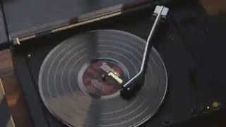
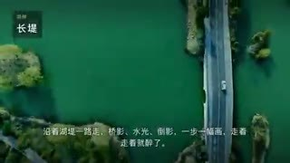

# Awesome Claude 5.5 Videos 

[中文](README.zh-CN.md) · [Complete source directory](docs/library.md) · [All documentation](docs/README.md)

Selected videos, animations and reusable projects made with Claude 5.5: Opus, Sonnet, Haiku and creator-reported Fable. Explore the work, learn how it was made, and study its recurring patterns through original sources and public data.

**[Browse](#browse-the-work) · [Research findings](#research-findings) · [Make-your-own](#make-your-own) · [Data and maintenance](#data-and-maintenance) · [Latest updates](#latest-updates)**

## Browse the work

<!-- collection-summary:start -->

As of 2026-10-11: **424 distinct source posts**, with **199 receiving nine-frame preview sampling**.

| Browse by model | Source posts |
|---|---:|
| [Opus](docs/library.md#opus) | 301 |
| [Sonnet](docs/library.md#sonnet) | 54 |
| [Haiku](docs/library.md#haiku) | 21 |
| [Fable](docs/library.md#fable) | 68 |

[Complete directory](docs/library.md) · [Evidence and account coverage](docs/collection-analysis.md) · [Batch totals](data/collection-summary.json)

<!-- collection-summary:end -->

Multi-model comparisons appear in several groups, so table rows do not add up. Source posts include replies and variants. Early Opus cases follow the original study scope; Fable retains creator-reported attribution.

| Opus | Sonnet | Haiku | Fable (creator report) |
|:---:|:---:|:---:|:---:|
|  |  |  |  |
| [Braun turntable film](https://x.com/nicceasy/status/2108018789468250448) | [Tower construction](https://x.com/Solvaix/status/2107548992640880755) | [West Lake footage edit](https://x.com/shengtang135754/status/2108934243636408790) | [Doodle history](https://x.com/oalanicolas/status/2107958931230241037) |
| 3D rendering and human direction | A staged interactive scene | Footage editing, chapters and captions | Changing eras and a recurring character |

These illustrate four different tasks, not a same-prompt model ranking. Previews received nine-frame sampling, which cannot verify full motion or model calls. Sampling notes: [October 10](docs/maintenance-2026-10-10-followup.md) · [October 11](docs/maintenance-2026-10-11.md).

[Browse frames by content and style](docs/domain-style-atlas.md) · [Browse production paths](docs/cases-index.zh-CN.md) · [Latest source review](docs/maintenance-2026-10-11.md)

## Research findings

Content and color findings below use the **1,119 included files from September 26, 2026**. Workflow findings use original posts, author replies and selected cases. The [research guide](docs/research-guide.md) links calculations and sources.

### Content and style: games lean toward 3D, ads toward motion graphics

**70.0%** of game/interactive files are labeled 3D render (161/230); **71.6%** of ad/launch files are labeled motion graphics/UI (154/215). Both remain the majority within their domains when only the clearer `yes` labels are included.

Education and stories have more varied looks. Their largest groups—motion graphics for education and flat cartoons for stories—account for 37.4% and 33.0%. Compare several treatments of a similar subject when choosing a production approach. [Explore the visual atlas](docs/domain-style-atlas.md) · [Check denominators and thresholds](docs/statistics.md)

### Color: a category can contain both dark and light treatments

The 350 motion-graphics/UI files split into **198 dark-neutral** and **152 light-neutral** examples. One average palette would hide these two design choices.

Music videos have a median colorful-pixel share of 45.5%, versus 17.6% for ads. Use this to explore visual references. Likes in the figure come from a separate September 27 post sample and do not establish which palette works better. [Read the color study](docs/color-modes.md)

### Production: track inputs, revisions and total task cost

[Three newly reviewed workflows](docs/workflow-analysis.md#october-11-automation-within-the-full-production-process) make the division of work clearer: the Haiku West Lake brief specifies footage, narration and segment timing; an Opus-plus-nine-Sonnets article video underwent timing and narration fixes; the turntable-film author describes nine days of production with several human decisions.

| Finding | Source examples | What to carry into your own project |
|---|---|---|
| A short request can have substantial inputs | A mixed-media brief supplies a skill, footage and frame-level direction; a Beijing brief calls for stock footage and external narration. | Prepare the assets, audio and delivery requirements together. [Input analysis](docs/workflow-analysis.md) |
| One human prompt can trigger many revisions | The F1 author says Opus rejected intermediate work repeatedly; five public briefs range from 172 to 17,664 visible characters. | Record human prompts and internal review separately; preserve the production conditions. [Prompt and input matrix, 中文](docs/prompt-matrix.zh-CN.md) |
| Compare the whole task bill | The bridge author reports $2.19 for Haiku and $3.04 for Opus; the F1 Haiku executor accounts for 64.2% of the reported team cost. | Include revisions, tools and external assets. Different tasks do not form a model ranking. [Cost analysis](docs/workflow-analysis.md) |

[Five research directions and practical findings](docs/research-guide.md) · [Model labels and sampling coverage chart](docs/collection-analysis.md) · [Duration, prompt lengths and full snapshot figures](docs/snapshot-analysis.md)

## Make your own

### Start with the task and production path

| Your task | Start with an example | Reusable guidance |
|---|---|---|
| Code-drawn 2D animation | [Ant colony and matching source](https://x.com/hanifproduktif/status/2102742924148830211) | [Prompt templates, 中文](docs/prompt-playbook.zh-CN.md) |
| An educational explainer | [Manim calculus lesson](https://x.com/LinearUncle/status/2103128559174971663) | [Content and visual checks](docs/visual-effects-fit.md) |
| A 3D or real-time scene | [Clearwater and WebGL source](https://x.com/Aurelien_Gz/status/2102786378282987591) | [Choosing a production method](docs/visual-effects-fit.md) |
| Transform existing footage | [Talking-head line-art remake](https://x.com/AxtonLiu/status/2102827887732932956) | [Paired input and production evidence](docs/evidence-examples.md) |
| Direct an external video model | [Opus with Seedance](https://x.com/abxxai/status/2102775755646337530) | [Model and renderer roles](docs/production-resources.md) |
| Build an interactive work | [Can-collection simulation](https://x.com/masaya_1980/status/2103115017755500561) | [Delivery and acceptance brief](docs/production-brief.md) |

### Reusable open-source projects

- [Lemo-Opuscar](https://github.com/lemomo-ai/lemo-opuscar): 43 styles, director and technique guides; plus [OPUSCAR 98 style and shot notes](https://lemomo-ai.github.io/lemo-opuscar/opuscar98/#styles).
- [Papermotion](https://github.com/francozanardi/papermotion): paper-animation template, characters, physics and offline rendering. Samples have individual model labels.
- [ClaudeAnimationBase](https://github.com/JohnHeibel/ClaudeAnimationBase): p5.js/p5.brush characters, shot timing and a frame renderer.
- [Motion Graphics Music Video skill](https://github.com/makevoid/motion-graphics-music-video-skill): a plugin for building an MV around a supplied song, with external image, video and audio tools.

- [3d-product](https://github.com/nicceasy/3d-product): a 3D product-film workflow with composition previews, rendering, finishing and human direction.
- [SwiftUI text animations](https://github.com/amosgyamfi/SwiftUI-Agent-Thinking-Text-Animations): 184 UI animation components; the author made two before asking Opus to extend the set.
- [Video Production Skills](https://github.com/Ucmp0001/video-production-skills): eleven skills for research, shots, voice/subtitle timing and delivery.

Seven READMEs and root licenses checked **October 11, 2026**. [Previews, starting files and revision records](docs/production-resources.md) · [Production brief](docs/production-brief.md) · [Seven prompt templates, 中文](docs/prompt-playbook.zh-CN.md)

## Data and maintenance

The current collection counts **source posts**; the September 26 content and color study counts **files**. The frozen study has 1,401 byte-distinct files, of which 1,119 enter the classification analysis, plus 168 closely reviewed source posts. Preview sampling records visible content; creator disclosures record production claims.

| What to check | Where to look |
|---|---|
| Current sources, model labels and sampling status | [Unified CSV](data/collection-index.csv) · [Collection analysis](docs/collection-analysis.md) |
| Content, style, duration and color calculations | [Statistical definitions](docs/statistics.md) · [Color methods](docs/color-modes.md) |
| Reproduce or update the repository | [Maintenance guide](docs/maintenance.md) · [Figure generation](docs/chart-generation.md) · [Contributing](CONTRIBUTING.md) |

The [documentation index](docs/README.md) connects every research direction, dated update and original long-form report.

## Latest updates

- [2026-10-11: new sources and project restructuring](docs/maintenance-2026-10-11.md).
- [2026-10-10: follow-up search, Haiku and workflow analysis](docs/maintenance-2026-10-10-followup.md).
- [2026-10-10: initial maintenance and Haiku review](docs/maintenance-2026-10-10.md).
- [Complete update archive](docs/README.md#update-archive).

## Contributing and license

[Submit a source, reusable project or correction](CONTRIBUTING.md). Distinct production methods, clear inputs and inspectable code are especially useful.

Original writing and charts use [CC BY 4.0](LICENSE). Linked works and stills belong to their creators; see [THIRD_PARTY.md](THIRD_PARTY.md). This independent project does not redistribute raw MP4s.
