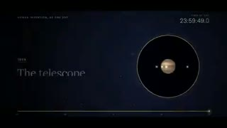
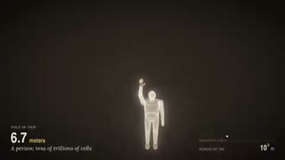

# Awesome Claude 5.5 Videos 

[English](README.md) · [看图找案例](docs/cases-index.zh-CN.md) · [参与维护](CONTRIBUTING.md)

精选**使用 Claude 5.5 参与制作**的视频、动画与可复用工程。覆盖 Opus、Sonnet、Haiku，以及作者报告的 Fable 灰度作品。每条案例链接原帖，说明 Claude 负责绘图代码、素材改编、外部模型调度，还是被录屏的应用。

## 目录

- [先看作品](#先看作品)
- [浏览目录](#浏览目录)
- [自己动手](#自己动手)
- [收录统计](#收录统计)
- [研究与数据](#研究与数据)
- [更新记录](#更新记录)
- [参与维护与许可](#参与维护与许可)

## 先看作品

| 历史 | 艺术 | 科学 |
|:---:|:---:|:---:|
|  |  |  |
| [把人类进步压缩成一天](https://x.com/imjustnewatai/status/2106081142143168580) · @imjustnewatai | [四万年艺术史，还有一只猫](https://x.com/cherry_mx_reds/status/2106095190285144331) · @cherry_mx_reds | [The Long Way Out](https://x.com/imjustnewatai/status/2106190594775097663) · @imjustnewatai |
| 用时钟连接历史与未来设想。 | 用持续出现的角色连接画风变化。 | 用一次缩放连接夸克、人物与星系。 |

三条均由作者称使用 Fable 5.5，后台身份未核实。我们查看了每段预览的九帧取样。[制作说明与证据](docs/claude55-update-2026-10-03.zh-CN.md)。

## 浏览目录

- [Haiku 视频与对照](docs/maintenance-2026-10-10.zh-CN.md#haiku-视频与对照)：诗歌、动效、三维鹈鹕、剪辑与图形对照。
- [看图找案例](docs/cases-index.zh-CN.md)：168 条深读来源帖，每条附截图、原帖和制作说明。
- [Claude 作品分类目录](docs/claude55-update-2026-10-03.zh-CN.md)：历史、科普、故事、发布片、音乐、游戏与视觉实验。
- [领域 × 画风图谱](docs/domain-style-atlas.zh-CN.md)：按内容和画风找有图案例。
- [制作证据对照](docs/evidence-examples.zh-CN.md)：外观相近，输入和工具不同。
- [Fable／Opus 与 Sonnet 对照](docs/claude55-update-2026-10-02.zh-CN.md)：早期作者反馈与来源记录。

## 自己动手

### 制作路径

- [程序二维绘图](https://x.com/hanifproduktif/status/2102742924148830211)：蚁群动画，附匹配源码。
- [知识讲解](https://x.com/LinearUncle/status/2103128559174971663)：Manim 微积分课。
- [三维与实时图形](https://x.com/Aurelien_Gz/status/2102786378282987591)：Clearwater 水面模拟，附 WebGL 工程。
- [已有素材改编](https://x.com/AxtonLiu/status/2102827887732932956)：把真人讲述改成线稿动画。
- [外部视频模型](https://x.com/abxxai/status/2102775755646337530)：Opus 调度 Seedance。
- [应用与游戏录屏](https://x.com/masaya_1980/status/2103115017755500561)：收集罐子的模拟程序。
- [混合流程与对照](https://x.com/leogao25/status/2102544078927741369)：分屏物理模拟比较。

[选制作方法](docs/visual-effects-fit.zh-CN.md) · [路径图文与来源核对](docs/production-resources.zh-CN.md) · [提示模板](docs/prompt-playbook.zh-CN.md) · [提示／工作流矩阵](docs/prompt-matrix.zh-CN.md)

### 开源工程

- [Lemo-Opuscar](https://github.com/lemomo-ai/lemo-opuscar)：画风库、导演指南与确定性 Canvas／WebGL 场景代码。
- [Papermotion](https://github.com/francozanardi/papermotion)：纸片动画引擎、角色骨架、物理与离线渲染。示例逐片标注模型。
- [ClaudeAnimationBase](https://github.com/JohnHeibel/ClaudeAnimationBase)：p5.js／p5.brush 角色动画、分镜与渲染底座。
- [Motion Graphics Music Video skill](https://github.com/makevoid/motion-graphics-music-video-skill)：根据歌曲制作动效视频的 Claude Code 插件与 Ruby 工具包，可调用外部图像、视频和音频模型。

[工程预览、可复用文件与来源说明](docs/production-resources.zh-CN.md)。工程说明核对于 9 月 27 日，外部项目可能继续变化。

## 收录统计

<!-- collection-summary:start -->

| 批次 | 来源帖 | 比此前新增 |
|---|---:|---:|
| [2026-09-26](data/cases.csv) | 168 | 168 |
| [2026-09-27](assets/new-case-thumbnails/frames.csv) | 7 | 7 |
| [2026-10-02](data/claude55-source-review-2026-10-02.csv) | 22 | 22 |
| [2026-10-03](data/claude55-source-review-2026-10-03.csv) | 157 | 157 |
| [2026-10-10](data/claude55-source-review-2026-10-10.csv) | 18 | 18 |

截至 2026-10-10，合计 **372 条去重来源帖**。

<!-- collection-summary:end -->

这里统计来源帖，含回复、对照和版本变体，不是独立影片数或已核实的模型运行次数。汇总按帖子 ID 跨批次去重。[可复算汇总](data/collection-summary.json)。

**9 月 26 日 Opus 冻结快照**含 1,401 个逐字节不同的文件，其中 1,119 个标为 `yes`／`likely`。主要结果：

- 游戏、广告与 AI 自谈占纳入文件的 **57.7%**。
- 动态图形／界面与三维渲染占 **60.2%**。
- 深读预览中位数为 **52.37 秒**，全部分类文件为 **39.20 秒**。两组的单位和选例方式不同。

[统计图与分析](docs/snapshot-analysis.zh-CN.md) · [完整统计](docs/statistics.zh-CN.md) · [配色研究](docs/color-modes.zh-CN.md)

## 研究与数据

- [方法](docs/methodology.zh-CN.md)、[检索覆盖](docs/search-coverage.zh-CN.md)与[媒体属性](docs/media-profile.zh-CN.md)。
- [深读案例](data/cases.csv)、[逐文件分类](data/domain-style.csv)与[字段说明](docs/case-index-guide.zh-CN.md)。
- [研究报告](docs/report.zh-CN.md)与[长文版本](docs/x-article.zh-CN.md)。
- [图表复现方法](docs/chart-generation.md)。完整图表放在研究专题页。

模型标注来自作者披露。取样画面能说明可见内容，不能核实隐藏工具调用、完整动态质量或音乐来源。仓库不分发原始 MP4 与私有采集记录。本项目独立维护。

## 更新记录

- [10 月 10 日：维护与近期来源复核](docs/maintenance-2026-10-10.zh-CN.md)。
- [10 月 3 日：Claude 作品分类目录](docs/claude55-update-2026-10-03.zh-CN.md)。
- [10 月 2 日：Fable 报告与 Sonnet 对照](docs/claude55-update-2026-10-02.zh-CN.md)。
- [9 月 27 日：七条新增工作流](docs/new-cases-2026-09-27.zh-CN.md)。
- [9 月 26 日：Opus 冻结研究快照](docs/snapshot-analysis.zh-CN.md)。

## 参与维护与许可

[提交原创作品或可复用工程](CONTRIBUTING.md)。优先收录不同的制作方法、清楚的输入或可检查的源码。欢迎纠错与补充原作者链接。

原创文字与图表使用 [CC BY 4.0](LICENSE)。链接作品和预览截图归原作者，按各自条款使用。[第三方素材说明](THIRD_PARTY.md)。
