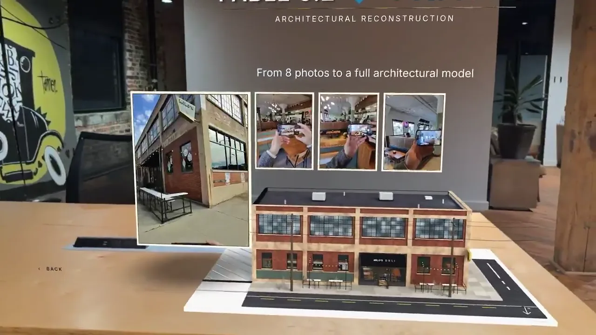
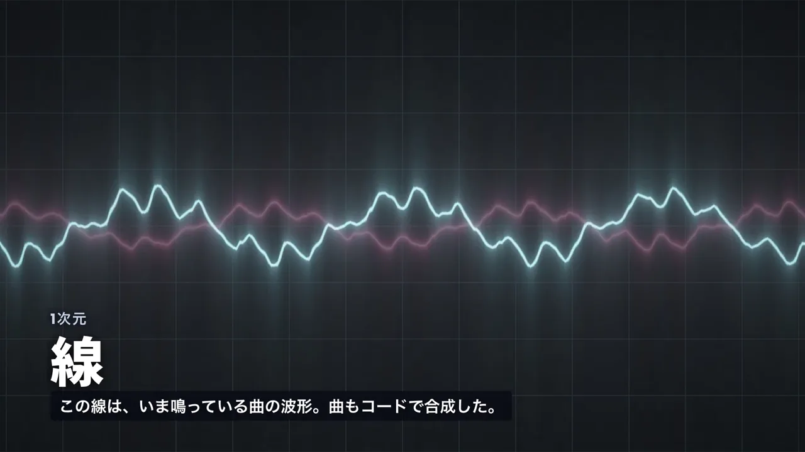
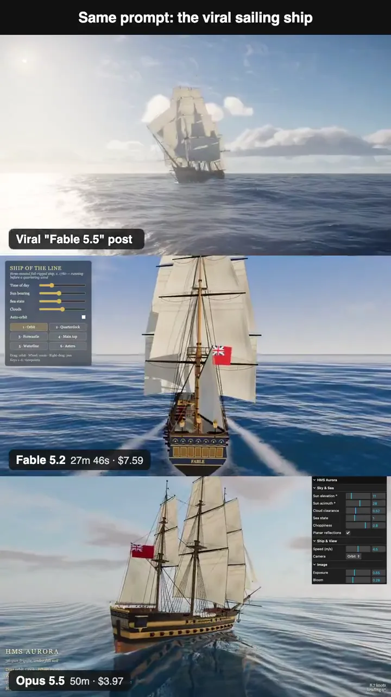
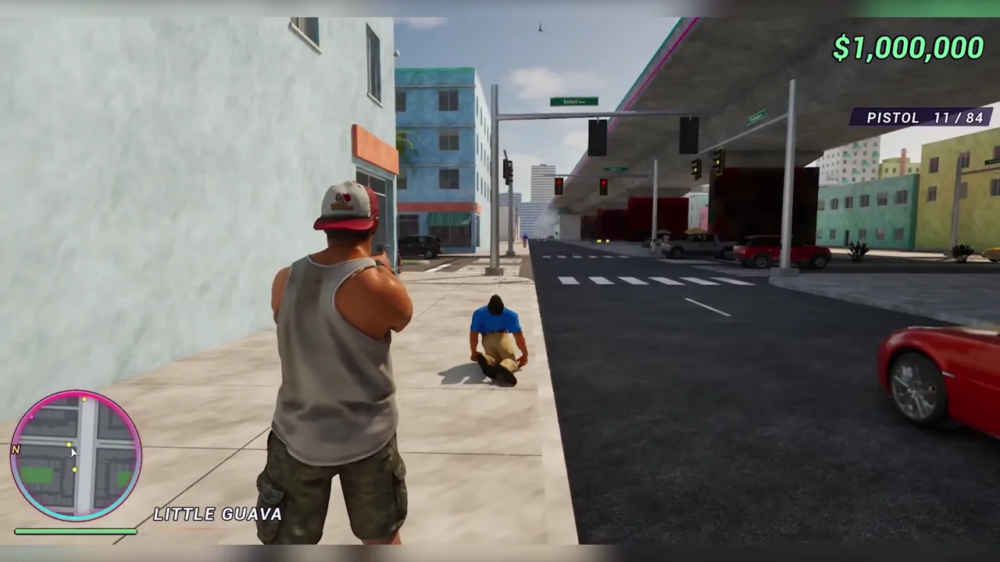
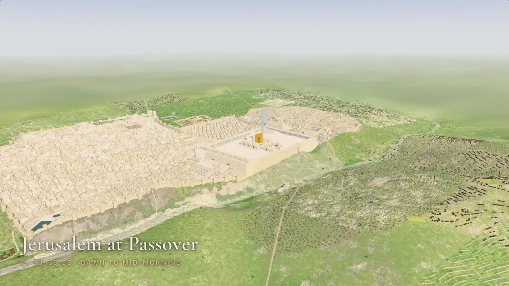
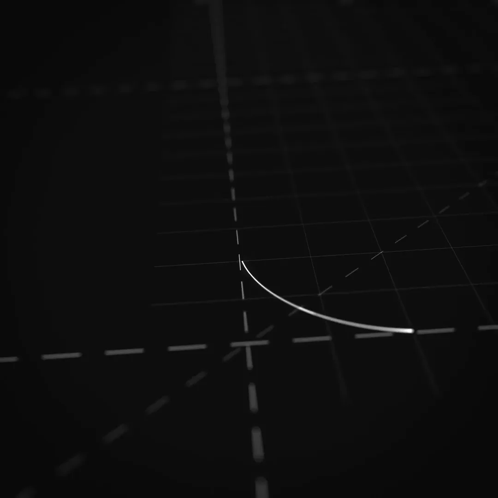
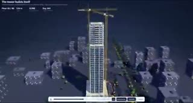
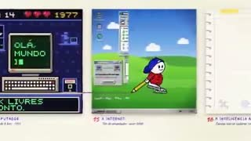
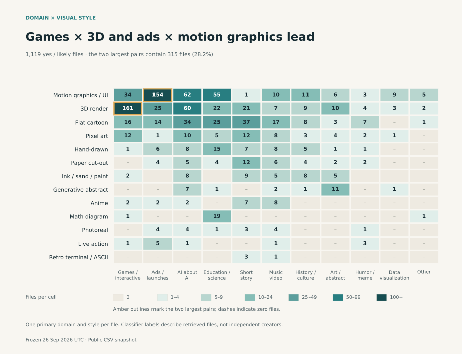
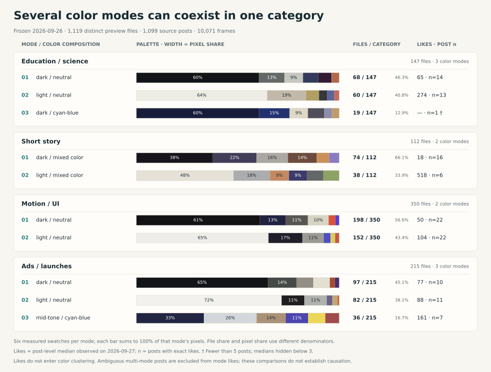

# Awesome Claude Videos 

[English](README.md) · [完整作品目录](docs/library.zh-CN.md) · [Fable 5.2 专题报告](docs/fable-5-2.zh-CN.md) · [全部文档](docs/README.zh-CN.md)

**不只是视频合集，而是一份“用 Claude 做视频”的实战地图。**
这里收录了自 2026 年 9 月 Opus 5.5 爆发到 **11 月 9 日 [Claude Fable 5.2](https://www.anthropic.com/claude/fable) 正式发布**以来的 **597 条可核验 X 原帖**——覆盖 Blender、Three.js、Remotion、AR 重建、纯代码音画同步与交互游戏，并附带同题耗时/费用对照、作者公开 Prompt 与基于 1,119 个文件的实证统计。

**[Fable 5.2 精选画廊](#fable-52-精选画廊) · [模型怎么选](#模型怎么选) · [按模型浏览全库](#作品入口) · [实证研究结论](#研究结论) · [自己动手](#自己动手)**

---

## Fable 5.2 精选画廊（2026-11-16 更新）

Anthropic 于 **2026 年 11 月 9 日** 正式发布 **Claude Fable 5.2**（$8 / $40 per M tokens）。本轮新增 **173 条 Fable 5.2 实测作品**（中位时长 30 秒，最长 10 分 15 秒），在 3D/AR 空间重建、纯代码音画同步和复杂场景一次通过率上提升显著。

<table>
<tr>
<td width="33%" valign="top">
 
<b><a href="https://x.com/Trace_AR/status/2121284000232714559">8 张照片重建午餐店：3D 模型与 AR 漫游</a></b> 
@Trace_AR · 1:08 · 3D / AR 
数小时内把 8 张实拍照片转为完整建筑 3D 模型与 AR 步行体验。
</td>
<td width="33%" valign="top">
 
<b><a href="https://x.com/tankazunori0914/status/2120012834461646927">从一个点到一个世界：纯代码着色器 + 合成音乐</a></b> 
@tankazunori0914 · 1:04 · 含公开 Prompt 
零外部音视频素材，用代码同时写出着色器视觉演进与合成配乐。
</td>
<td width="33%" valign="top">
 
<b><a href="https://x.com/leohuanfang/status/2120024307573137874">帆船场景同题复现：Fable 5.2 vs Opus 5.5</a></b> 
@leohuanfang · 同题对比 · 27m46s / $7.59 
Fable 5.2 一次打开零报错通过；同题 Opus 5.5 耗时 50 分钟且需 3 轮修复。
</td>
</tr>
<tr>
<td width="33%" valign="top">
 
<b><a href="https://x.com/ericmaskfr/status/2119910195325481026">迈阿密风格开放世界游戏（含改装店与计时赛）</a></b> 
@ericmaskfr · 2:15 · 含公开 Prompt 
可直接游玩的 3D 城市驾驶与任务系统，附完整 Prompt。
</td>
<td width="33%" valign="top">
 
<b><a href="https://x.com/kplikethebird/status/2119900775727902732">逾越节的耶路撒冷：从圣殿到阶梯街 3D 漫游</a></b> 
@kplikethebird · 0:30 · 含公开 Prompt 
历史建筑群长镜头 3D 穿越，展示复杂场景的空间调度能力。
</td>
<td width="33%" valign="top">
 
<b><a href="https://x.com/hello_amani/status/2119873980786237842">amani/studio：从蓝图网格生成的镀铬 Logo 动画</a></b> 
@hello_amani · 0:36 · 含公开 Prompt 
精致的品牌动效与材质光影，适合作为产品片开场模板。
</td>
</tr>
</table>

> 查看全部 173 条 Fable 5.2 案例分类分析与 17 个可直接复制的作者 Prompt，请进 **[Fable 5.2 专题报告](docs/fable-5-2.zh-CN.md)**。

---

## 模型怎么选？（基于实测对比与费用披露）

结合 15 组 Fable 5.2 同题对比与 Claude 5.5 工作流记录，不同模型在视频制作中的定位差异非常明显：

| 模型 | 最适合的视频任务 | 真实制作特征（来源实测披露） | 注意事项 |
|---|---|---|---|
| **Fable 5.2** | 复杂 3D/AR 场景、Blender 建模、代码直出音画、高复杂度一镜到底 | 一次成片零报错率高（如帆船任务 27m / $7.59 一次通过），最长成片达 10 分钟 | 自主多轮验证更深，开放式任务输出 token 密度高（有 Motion 对照单次达 $88.09） |
| **Opus 5.5** | 常规 Motion Graphics、产品发布片、多 Agent 导演编排 | 生态最成熟（311 条案例），审美与转场稳定，可配合大量开源 Skill | 复杂 3D/物理场景可能需要 2–3 轮人工驳回修复 |
| **Sonnet 5.5** | 交互式分步讲解、中等复杂度动画、作为 Opus 的执行子工 | 性价比高，常与 Opus 配合担任分镜/片段执行角色 | 独立做长篇或高难度 3D 时细节上限低于 Fable 5.2 / Opus 5.5 |
| **Haiku 5.5** | 已有实拍/图库素材剪辑、字幕与章节编排、批量轻量执行 | 极低单价与快速响应（如西湖宣传片报告费用仅 4 元人民币） | 单价低不等于总账一定便宜；若频繁返工，执行端占比仍可能高达 64% |

---

## 按模型浏览全库

<!-- collection-summary:start -->

截至 2026-11-16：**597 条去重来源帖**（其中 **199 条有九帧预览取样**）。

| 模型浏览入口 | 来源帖 |
|---|---:|
| [Fable 5.2](docs/library.zh-CN.md#fable-5-2) | 173 |
| [Opus 5.5](docs/library.zh-CN.md#opus-5-5) | 311 |
| [Sonnet 5.5](docs/library.zh-CN.md#sonnet-5-5) | 54 |
| [Haiku 5.5](docs/library.zh-CN.md#haiku-5-5) | 21 |
| [Fable（早期灰度 / 疑似 5.5）](docs/library.zh-CN.md#fable-pre-release) | 72 |

[完整目录](docs/library.zh-CN.md) · [Fable 5.2 专题报告](docs/fable-5-2.zh-CN.md) · [证据与作者分布](docs/collection-analysis.zh-CN.md) · [批次汇总](data/collection-summary.json)

<!-- collection-summary:end -->

> 多模型同题对比会同时计入多个分组，表格行不能简单相加。`Fable 5.2` 为 2026-11-09 正式发布后的作者披露案例；10 月初社区猜测的“疑似 Fable 5.5”路由案例保留在 `Fable（早期灰度）` 中。

### Claude 5.5 经典作品入口（九帧取样预览）

| Opus 5.5 | Sonnet 5.5 | Haiku 5.5 | Fable（早期灰度） |
|:---:|:---:|:---:|:---:|
|  |  |  |  |
| [Braun 唱盘产品片](https://x.com/nicceasy/status/2108018789468250448) | [建楼示意](https://x.com/Solvaix/status/2107548992640880755) | [西湖素材宣传片](https://x.com/shengtang135754/status/2108934243636408790) | [涂鸦人类史](https://x.com/oalanicolas/status/2107958931230241037) |
| 三维渲染与人的导演决策 | 逐步建造的交互场景 | 素材剪辑、章节与字幕 | 年代变化与持续角色 |

---

## 实证研究结论（来自 1,119 个文件与工作流审计）

除了收集链接，我们还在 2026 年 9 月底对 **1,119 个纳入视频文件**做了领域、画风、片长与像素级配色统计（完整口径与数据见[研究导读](docs/research-guide.zh-CN.md)）：

### 1. 领域决定画风：游戏偏 3D，广告偏动态图形
- **游戏 / 交互** 中 **70.0%**（161/230）采用三维渲染；**广告 / 发布片** 中 **71.6%**（154/215）采用动态图形 / 界面。
- **教育**（最大组占 37.4%）与 **故事**（33.0%）画风高度分散，选型时可参考[内容 × 画风图谱](docs/domain-style-atlas.zh-CN.md)。

### 2. 配色不是一张平均色卡：同类别内深浅两极分化
- 350 个动态图形 / 界面文件中，**深色中性组（198 个）** 与 **浅色中性组（152 个）** 几乎平分秋色；音乐视频彩色像素占比中位数达 **45.5%**，而广告仅为 **17.6%**。[完整配色研究](docs/color-modes.zh-CN.md)

### 3. 成本真相：看整项任务的输入与返工，而不只是 token 单价
- 一句简短提示词背后常配合着定制 Skill、参考素材与多轮内部驳回；建议结合[提示与条件矩阵](docs/prompt-matrix.zh-CN.md)和[制作方式分析](docs/workflow-analysis.zh-CN.md)设计任务单。

---

## 自己动手：模板与开源工程

### 想做什么，直接按表抄作业

| 想做什么 | 参考案例 | 可复用模板 / 指南 |
|---|---|---|
| **直接抄 Fable 5.2 提示词** | [17 个作者公开 Prompt 索引](docs/fable-5-2.zh-CN.md#17-个作者公开的-prompt-索引) | 覆盖动效 Showreel、3D 漫游、开放世界小游戏 |
| **二维代码动画（零素材）** | [蚁群动画与对应源码](https://x.com/hanifproduktif/status/2102742924148830211) | [零外部视觉素材模板](docs/prompt-playbook.zh-CN.md#1-零外部视觉素材的代码动画) |
| **数学 / 知识讲解** | [Manim 微积分课](https://x.com/LinearUncle/status/2103128559174971663) | [内容与视觉验收标准](docs/visual-effects-fit.zh-CN.md) |
| **三维或 WebGL 场景** | [Clearwater 水面与 WebGL 工程](https://x.com/Aurelien_Gz/status/2102786378282987591) | [三维场景分步模板](docs/prompt-playbook.zh-CN.md#4-三维场景把建场景与拍电影分开) |
| **改编已有视频/图片素材** | [真人口播变线稿](https://x.com/AxtonLiu/status/2102827887732932956) | [输入与制作证据对照](docs/evidence-examples.zh-CN.md) |
| **调度外部视频生成模型** | [Opus 调度 Seedance](https://x.com/abxxai/status/2102775755646337530) | [导演与生成工具分工](docs/production-resources.zh-CN.md) |

### 值得 Star 的开源视频工程

- **[Lemo-Opuscar](https://github.com/lemomo-ai/lemo-opuscar)**：43 种画风、导演与技术指南，附 [OPUSCAR 98 风格与镜头参考](https://lemomo-ai.github.io/lemo-opuscar/opuscar98/#styles)。
- **[Papermotion](https://github.com/francozanardi/papermotion)**：纸片动画模板、角色系统、物理与离线渲染。
- **[ClaudeAnimationBase](https://github.com/JohnHeibel/ClaudeAnimationBase)**：基于 p5.js / p5.brush 的角色与分镜时间线渲染底座。
- **[Motion Graphics Music Video skill](https://github.com/makevoid/motion-graphics-music-video-skill)**：围绕音乐节拍组装 MV 的自动化 Skill。
- **[3d-product](https://github.com/nicceasy/3d-product)**：产品三维影片流程，包含构图预览与人类导演介入检查点。
- **[SwiftUI Agent Thinking Text Animations](https://github.com/amosgyamfi/SwiftUI-Agent-Thinking-Text-Animations)**：184 个界面动效组件。
- **[Video Production Skills](https://github.com/Ucmp0001/video-production-skills)**：11 个覆盖调研、分镜、配音与交付的模块化 Skill。

---

## 数据架构与贡献

本仓库采用 **“增量来源账本 + 冻结研究快照”** 双轨架构，由 `scripts/collection/` 模块化流水线自动生成目录、图表与统计：

- 校验并生成当前目录：`python3 scripts/maintain.py generate --scope collection`
- 完整文档地图：[docs/README.zh-CN.md](docs/README.zh-CN.md) · 贡献新案例：[CONTRIBUTING.md](CONTRIBUTING.md) · 维护指南：[docs/maintenance.md](docs/maintenance.md)
