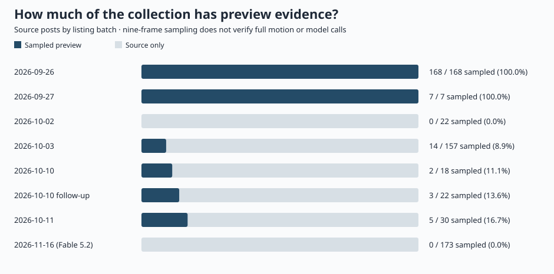

# Collection and evidence analysis

[Home](../README.md) · [Directory](library.md) · [中文](collection-analysis.zh-CN.md)

These statistics describe selected source posts in this repository. They do not estimate X-wide prevalence or rank models. All figures derive from [the unified source index](../data/collection-index.csv), generated by `scripts/generate_collection_summary.py`.

## Evidence coverage

| Unit | Count | Meaning |
|---|---:|---|
| Distinct source posts | 597 | Includes replies, comparisons and variants |
| Posts with nine-frame preview sampling | 199 (33.3%) | Posts, not attachments or full-playback acceptance |
| Posts without preview sampling | 398 | Source disclosures, including context discussion |
| Routing-context posts | 6 | Included in total sources; kept separate from examples |

## Model labels in incremental batches

Use the **416 non-routing-context sources listed since October 2**, avoiding the 168 older Opus-focused cases as a cross-model denominator.

| Model label | Source posts | With sampling |
|---|---:|---:|
| Fable 5.2 | 173 | 0 |
| Opus 5.5 | 136 | 5 |
| Sonnet 5.5 | 54 | 3 |
| Haiku 5.5 | 21 | 4 |
| Fable (pre-release / suspected 5.5) | 71 | 15 |

38 sources mention multiple models (mostly side-by-side comparisons); 1 match no explicit versioned label. Rows therefore cannot be summed.

## Source-account concentration

The collection contains **471 case-insensitive publishing handles**. The five most represented accounts contribute 42/597 (7.0%). A publishing handle is not necessarily an original creator.

| Publishing handle | Source posts |
|---|---:|
| @higgsfield_ai | 15 |
| @imjustnewatai | 11 |
| @blueemi99 | 6 |
| @cherry_mx_reds | 5 |
| @chetaslua | 5 |

## Batches and snapshot boundary

| Batch | Source posts | New to earlier batches |
|---|---:|---:|
| [2026-09-26](../data/cases.csv) | 168 | 168 |
| [2026-09-27](../assets/new-case-thumbnails/frames.csv) | 7 | 7 |
| [2026-10-02](../data/claude55-source-review-2026-10-02.csv) | 22 | 22 |
| [2026-10-03](../data/claude55-source-review-2026-10-03.csv) | 157 | 157 |
| [2026-10-10](../data/claude55-source-review-2026-10-10.csv) | 18 | 18 |
| [2026-10-10 follow-up](../data/claude55-source-review-2026-10-10-followup.csv) | 22 | 22 |
| [2026-10-11](../data/claude55-source-review-2026-10-11.csv) | 30 | 30 |
| [2026-11-16 (Fable 5.2)](../data/source-review-2026-11-16-fable52.csv) | 173 | 173 |

Batches use first-listing dates, not a publication trend. See [the latest update](fable-5-2.md) for details. September 26 file-level domain, style, duration and color results remain in [frozen snapshot analysis](snapshot-analysis.md); the units are not merged.
