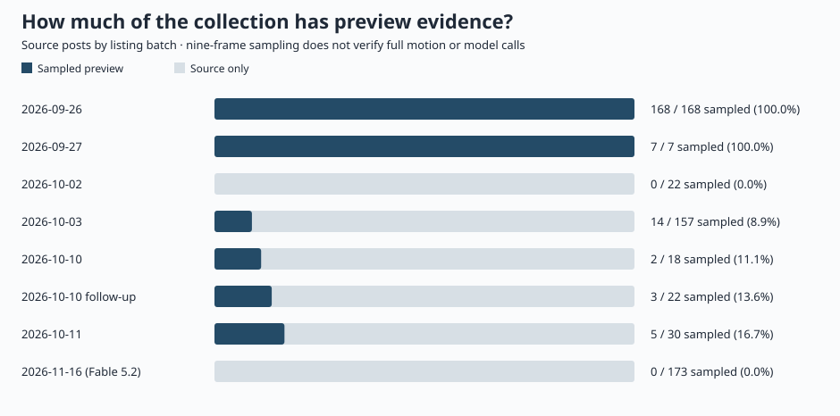

# 收录与证据分析

[首页](../README.zh-CN.md) · [目录](library.zh-CN.md) · [English](collection-analysis.md)

这些统计描述本仓库选中的来源帖，不估计 X 全站比例，也不评价模型优劣。全部数字来自[统一来源索引](../data/collection-index.csv)，由 `scripts/generate_collection_summary.py` 生成。

## 证据覆盖

| 单位 | 数量 | 解释 |
|---|---:|---|
| 去重来源帖 | 597 | 含回复、对照与版本变体 |
| 有九帧预览取样 | 199 (33.3%) | 按帖子计数，不是附件数或完整播放验收 |
| 尚无媒体取样 | 398 | 来源披露，含背景讨论 |
| 路由背景讨论 | 6 | 属于总来源数；单列，不当作作品 |

## 增量批次的模型标签分布

统计 10 月 2 日起的 **416 条非路由讨论来源**，避免把早期专搜 Opus 5.5 的 168 条深读样本当成跨模型分布。

| 模型标签 | 来源帖 | 有取样 |
|---|---:|---:|
| Fable 5.2 | 173 | 0 |
| Opus 5.5 | 136 | 5 |
| Sonnet 5.5 | 54 | 3 |
| Haiku 5.5 | 21 | 4 |
| Fable（早期灰度 / 疑似 5.5） | 71 | 15 |

其中 38 条同时提到多个模型（多为同题对比），1 条未匹配明确的版本标签。因此表格行不能相加。

## 来源作者分布

总来源涉及 **471 个不区分大小写的发布账号**。帖数最多的五个账号占 42/597（7.0%）。发布账号不一定是原创作者。

| 发布账号 | 来源帖 |
|---|---:|
| @higgsfield_ai | 15 |
| @imjustnewatai | 11 |
| @blueemi99 | 6 |
| @cherry_mx_reds | 5 |
| @chetaslua | 5 |

## 各批次与历史快照边界

| 批次 | 来源帖 | 比此前新增 |
|---|---:|---:|
| [2026-09-26](../data/cases.csv) | 168 | 168 |
| [2026-09-27](../assets/new-case-thumbnails/frames.csv) | 7 | 7 |
| [2026-10-02](../data/claude55-source-review-2026-10-02.csv) | 22 | 22 |
| [2026-10-03](../data/claude55-source-review-2026-10-03.csv) | 157 | 157 |
| [2026-10-10](../data/claude55-source-review-2026-10-10.csv) | 18 | 18 |
| [2026-10-10 follow-up](../data/claude55-source-review-2026-10-10-followup.csv) | 22 | 22 |
| [2026-10-11](../data/claude55-source-review-2026-10-11.csv) | 30 | 30 |
| [2026-11-16 (Fable 5.2)](../data/source-review-2026-11-16-fable52.csv) | 173 | 173 |

批次按首次收录日期组织，不是作品发布趋势。最新批次说明见[本轮专题](fable-5-2.zh-CN.md)。9 月 26 日逐文件领域、画风、片长和配色分析保留在[冻结快照分析](snapshot-analysis.zh-CN.md)。两套单位不混算。
