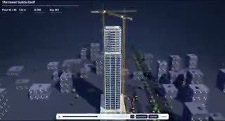
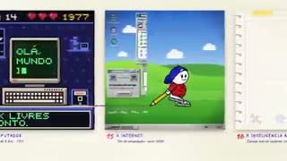

# 10 月 10 日补搜：工作流、Haiku 与更多来源

[首页](../README.zh-CN.md) · [完整目录](library.zh-CN.md) · [English](maintenance-2026-10-10-followup.md)

新增 **22 条来源帖**，其中八条涉及 Haiku。我们补搜八组查询，返回 400 行，全部达到五十条上限；另读 3 个作者线程。纳入引用帖并去重后，本轮记录 486 个候选 ID。

搜索请求使用分段日期窗口，但按响应中的时间字段核对，有 **233 行**落在所请求的窗口外。这里保留实际结果，不声称覆盖了指定窗口。它们仍可作为补搜线索；新收录逐条核对原帖与作者披露。

[搜索与时间核对](../data/claude55-search-coverage-2026-10-10-followup.csv) · [候选处理](../data/claude55-candidate-audit-2026-10-10-followup.csv) · [来源账本](../data/claude55-source-review-2026-10-10-followup.csv)

## 三段取样预览

| Haiku 动效 | Sonnet 建楼示意 | Fable 人类史 |
|:---:|:---:|:---:|
|  |  |  |
| 30.059 秒 | 29.118 秒 | 88.853 秒 |

每段预览用 ffprobe 探测并取九帧人工查看，三段均有音轨。Sonnet 原帖的六十八秒是所述时间线，取得的录屏约二十九秒。其余条目仅做来源复核。完整动态、卡点、模型调用与音乐原创未独立验证。

## 新增来源

| 原帖 | 模型／制作角色 | 制作说明 |
|---|---|---|
| [CoLateral 宣传片](https://x.com/nvandewetering/status/2107989438227779883) · @nvandewetering | Haiku 5.5 | 作者称用 Haiku 制作宣传片，耗时八分钟、费用三十八美分，也明确说效果并不出色。 |
| [限定素材与配音的北京宣传片](https://x.com/shengtang135754/status/2108549555528872041) · @shengtang135754 | Haiku 5.5 + MiniMax narration + sourced footage | 作者提示要求自行寻找素材、使用 MiniMax 配音、多角度镜头，并同步旁白与文字。 |
| [电机原理动画对照](https://x.com/rubenssoto_ai/status/2107919226728050775) · @rubenssoto_ai | Haiku 5.5 / Sonnet 5.5 | 作者用相同三维电机原理动画任务比较两个模型，报告耗时十一分十三秒和三十三分三秒。 |
| [金门桥场景的任务费用对照](https://x.com/Solomonrojie/status/2108322280094728219) · @Solomonrojie | Haiku 5.5 / Opus 5.5 | 作者从空文件夹出发，用相同 Three.js 金门桥任务对照，报告 Haiku 费用二点一九美元、Opus 三点零四美元。 |
| [代码与 Blender 动效](https://x.com/badboyfoxy/status/2108089492016103775) · @badboyfoxy | Haiku 5.5 | 作者称让 Haiku 展示动效设计能力，使用代码与 Blender，制作耗时二十四分钟。 取样可见标题、缓动曲线、轨道图形与竖向光条。 |
| [SVG 鹈鹕骑车对照](https://x.com/xueyu1125/status/2108082476975554587) · @xueyu1125 | Haiku 5.5 / GPT-6 Luna | 作者比较 SVG／H5 鹈鹕骑车动画，Haiku 使用 OpenCode、Luna 使用 Codex；执行工具不同。 |
| [夜间列车反向案例](https://x.com/EnvolDev/status/2107973447230091623) · @EnvolDev | Haiku 5.5 / GPT-6 Luna | 作者在夜间列车测试中更喜欢 Luna，并报告其耗时与费用低于 Haiku；与看好 Haiku 的案例并列保留。 |
| [F1 进站的规划与执行模型对照](https://x.com/rubenssoto_ai/status/2108289170871582851) · @rubenssoto_ai | Opus 5.5 + Haiku 5.5 / GPT models | 作者用 Opus 规划、Haiku 执行程序化 Three.js 进站动画，并对照 Sol／Luna 团队。 |
| [Understory 程序绘图角色游戏](https://x.com/DannyLimanseta/status/2107505970809336071) · @DannyLimanseta | Sonnet 5.5 | 作者说明用 Three.js 制作五种地貌的动作解谜游戏，二维美术由代码绘制，花费数天并有人类指导。 |
| [Slow Me Down 亲子短片](https://x.com/kevin_t_ngo/status/2106864721525915941) · @kevin_t_ngo | Sonnet 5.5 | 作者将一部父亲故意在游戏中输给女儿的短片归于 Sonnet，并说明使用真实 Claude Code 会话。 |
| [示意性高楼建造动画](https://x.com/Solvaix/status/2107548992640880755) · @Solvaix | Sonnet 5.5 | 作者说明单 HTML 的四十层楼建造动画，并明确说顺序是编排的、几何被简化，未进行工程计算。 取样可见楼体逐步升高与吊车位置变化。取得的录屏约二十九点一一八秒，原帖描述的是六十八秒时间线。 |
| [毛茸茸螃蟹的同提示对照](https://x.com/vib3coded/status/2108190478889824662) · @vib3coded | Opus 5.5 / Sonnet 5.5 | 作者用相同提示比较两个螃蟹场景，报告费用十三点三零和十一点二五美元。 |
| [经典火柴人打斗](https://x.com/AndrewOnXYZ/status/2107262468502544435) · @AndrewOnXYZ | Reported Fable 5.5 | 作者称让 Fable 制作经典火柴人打斗动画。 |
| [Balatro 与英雄联盟结合的游戏](https://x.com/Vince__Russell/status/2107315127292952696) · @Vince__Russell | Reported Fable 5.5 | 作者说明在 Tesana 上制作 Three.js 游戏，将牌型映射为英雄击杀与倍率。 |
| [用涂鸦讲述人类史](https://x.com/oalanicolas/status/2107958931230241037) · @oalanicolas | Reported Fable 5.5 | 作者说明八十八秒短片覆盖十六个时代，绘画技法与音乐随时代变化。 取样可见持续出现的手绘角色跨越年代画框，画面从纸墨变化为像素游戏风格。 |
| [提供参考与 skill 的重建](https://x.com/notdwd/status/2107816799840690589) · @notdwd | Reported Fable 5.5 | 作者提供 skill 与任务说明。公开回复明确要求侧脸和手部素材，含 Pexels 默认片段、歌曲、纸张纹理与逐帧时间安排，用于混合媒体短片。 |
| [跨越距离的半条毯子](https://x.com/Vallabh469/status/2108494077389926611) · @Vallabh469 | Opus 5.5 | 作者自己设计概念、叙事与角色设定，称 Opus 负责分屏构图、角色动画与声音设计。 |
| [声音与运动驱动的混合画面](https://x.com/aicreataro/status/2108091976574988390) · @aicreataro | Opus 5.5 + Blender + MiniMax + Midjourney | 作者说明人物用 MiniMax H3、主视觉用 Midjourney、音乐用 MiniMax，再用 Blender／Python 根据声音和运动驱动深度、粒子与镜头。 |
| [结合 Higgsfield 的角色场景](https://x.com/luqmanedits/status/2108476552057172312) · @luqmanedits | Opus 5.5 + Higgsfield | 作者说明场景使用 Opus 与 Higgsfield，并明确提到角色设定、地点与最终动画的 Higgsfield 环节。 |
| [使用作者真人声音的模型主题片](https://x.com/dorszafranski/status/2108493804068118778) · @dorszafranski | Opus 5.5 + creator voice | 作者将 Mistral 主题视频归于 Opus，并明确说明声音是自己的。 |
| [多轮修改的发布片](https://x.com/_MasterMal/status/2108471807372325100) · @_MasterMal | Opus 5.5 | 作者称用 Opus 制作 usevano 发布片，并经历多轮修改。 |
| [数据与动作捕捉驱动的进球重建](https://x.com/lv_feng47448/status/2108397996740432136) · @lv_feng47448 | Opus 5.5 + Blender + data + mocap | 作者说明使用 StatsBomb 360 位置、球体物理与动作捕捉，用 Blender 渲染，并指出球员外观仍粗糙。 |

## 读完以后

[制作方式分析](workflow-analysis.zh-CN.md)讨论输入、代码绘图与素材编辑、模型分工、修改轮次和费用口径。[收录分析](collection-analysis.zh-CN.md)给出可复算的模型标签、取样覆盖与作者集中度。[统一目录](library.zh-CN.md)合并所有日期批次。
