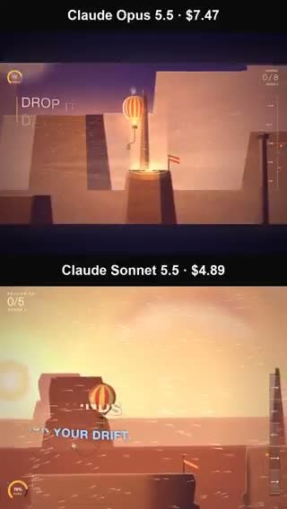
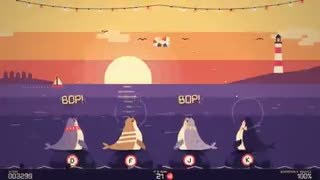

# October 11 update: inputs, model roles and revisions

[Home](../README.md) · [Complete directory](library.md) · [中文](maintenance-2026-10-11.zh-CN.md)

Adds **30 source posts**, **6 involving Haiku**. Five previews were inspected through nine sampled frames each. The listing date records discovery in this run, not the release date of every work. Source posts are not independent films.

## Three production lessons

- **List the inputs and roles.** [The West Lake promo](https://x.com/shengtang135754/status/2108934243636408790) assigns media editing, narration and captions to a Haiku workflow; [Follow the Crumbs](https://x.com/sarit69976/status/2109072935998681436) combines separate image, video and music tools.
- **Record revisions when reporting a single prompt.** [The Opus / nine-Sonnet article workflow](https://x.com/agito20211021/status/2108852733792891379) includes internal fixes; [another creator’s showreel](https://x.com/MaciejPoczek/status/2108924468110176457) took 71 messages.
- **Controllable 3D still has production costs.** [The pinned 3d-product README](https://github.com/nicceasy/3d-product/blob/b7e2025cbcb33ffd9625cd21ad506343b8b6e83d/README.md) describes nine days of work, four GPUs, human decisions at production stages and external assets. A public skill provides a workflow, not a zero-cost finished film.

## Five sampled previews

| Preview and original post | Sampled observation |
|---|---|
|  West Lake footage edit · 107.067 s | Samples show landscape footage with chapter labels and Chinese captions. Location and footage licences were not independently checked. |
|  Thermal Courier game trailer comparison · 15.061 s | Samples show two stacked balloon scenes with model/cost labels, changing terrain and trailer text. |
|  Article-to-video with nine scene workers · 61.419 s | Samples show a vertical sequence of Japanese text, diagrams, numbers and photographic scenes. The acquired preview is 61.419 seconds. |
|  Low Tide Shuffle rhythm game · 30.059 s | Samples show Low Tide Shuffle with four seal lanes, changing prompts and score indicators. |
|  Braun PS550 product film and 3d-product skill · 97.963 s | Samples show the turntable, tonearm and room across close-ups and wider lighting changes. |

Each preview was probed with ffprobe and inspected through nine ffmpeg fast-seek frames. All five have audio tracks. This confirms sampled frames only; full playback, audiovisual timing, model calls and music provenance were not independently verified. These previews stay outside the frozen September 26 file-level statistics.

## Added sources

| Original post | Model / production role | Production notes |
|---|---|---|
| [West Lake footage edit](https://x.com/shengtang135754/status/2108934243636408790) · @shengtang135754 | Haiku 5.5 + Pixabay footage + Volcengine narration | Creator reports CNY 4 and supplies a brief for stock footage, separately timed narration, chapter labels, captions and music. The workflow edits supplied or retrieved media. Samples show landscape footage with chapter labels and Chinese captions. Location and footage licences were not independently checked. |
| [Bee with a disclosed wing defect](https://x.com/letdarky/status/2108936071409000539) · @letdarky | Haiku 5.5 | Creator reports about six minutes on Max effort and explicitly notes that the wings look wrong in places. |
| [Bee comparison follow-up](https://x.com/letdarky/status/2108992110598697376) · @letdarky | Sonnet 5.5 / Haiku 5.5 | The same creator shares a Sonnet Max follow-up to the Haiku bee and prefers this result, but does not give a measured Sonnet runtime. |
| [Flexible glowing rod comparison](https://x.com/noclipepe/status/2109076746524045447) · @noclipepe | Haiku 5.5 / GPT-6 Luna / Gemini 3.8 Flash | Creator reports a shared stiffness-changing rod task: Haiku Medium 31m25s and about USD 0.69; Luna Medium 10m36s and about USD 0.16; Gemini High four minutes and about USD 0.10. This is a visual comparison with different effort labels, not a validated physics benchmark. |
| [Thermal Courier game trailer comparison](https://x.com/jeffbruchado/status/2108951077991362922) · @jeffbruchado | Opus 5.5 / Sonnet 5.5 | Creator reports one HTML file without external assets, including sound. Opus: 47m34s, 662 lines, estimated USD 7.47. Sonnet: 44m28s, 1,343 lines, estimated USD 4.89. The post shares a side-by-side preview of the two trailers. Samples show two stacked balloon scenes with model/cost labels, changing terrain and trailer text. |
| [Chroma Sweep gallery-heist trailer](https://x.com/jeffbruchado/status/2109041668595069182) · @jeffbruchado | Opus 5.5 / Sonnet 5.5 | Creator gives both models the same raycaster game-and-trailer brief. Reported runtimes are 52m25s and 51m12s, with estimated API costs of USD 7.29 and USD 5.36 respectively. |
| [End of Humanity: narrative versus generated footage](https://x.com/nonodigitalart/status/2109038670611100001) · @nonodigitalart | Sonnet 5.5 narrative + Google Flow / Omni Flash video | Creator assigns the narrative to Sonnet and the video generation to Google Flow with Omni Flash. This is a mixed-model production disclosure. |
| [After Effects particle-plugin prototype](https://x.com/learson_move/status/2108906894379344339) · @learson_move | Sonnet 5.5 + After Effects + DeepGlow | Creator says Sonnet coded a particle-plugin prototype, combined with DeepGlow, and that further adjustments are needed. The post has three preview attachments; this entry is source-only. |
| [Article-to-video with nine scene workers](https://x.com/agito20211021/status/2108852733792891379) · @agito20211021 | Opus 5.5 lead + Sonnet 5.5 scene workers + external media tools | Creator assigns planning/script/design to Opus and parallel scene work to nine Sonnet workers, with HyperFrames, Gemini music/TTS, Whisper and generated images. Disclosed internal fixes include spoken stage directions, shortening 84 seconds to 61, and a final fade. Samples show a vertical sequence of Japanese text, diagrams, numbers and photographic scenes. The acquired preview is 61.419 seconds. |
| [Follow the Crumbs mixed-tool film](https://x.com/sarit69976/status/2109072935998681436) · @sarit69976 | Opus 5.5 direction/editing + Magnific + Seedance 2.5 + ElevenLabs | Creator credits Claude with story, script, tool direction and editing; characters are designed with Magnific, footage generated with Seedance on Higgsfield, and music with ElevenLabs. |
| [Hangul Day code animation](https://x.com/danialnamkr/status/2109070380711481599) · @danialnamkr | Opus 5.5 | Creator says the Hangul-themed animation was made with Opus using code and no video model. Historical statements in the film have not been fact-checked in this review. |
| [Interactive Edo-kiriko glass](https://x.com/mizugame_22/status/2109067132839579693) · @mizugame_22 | Opus 5.5 + Three.js | Creator describes a Three.js experience where tapping selected patterns engraves a glass and changes patterned light in its shadow; the result can be shared by link. |
| [Falcon 9 landing visualization](https://x.com/konstantinsaifo/status/2109061641027678483) · @konstantinsaifo | Opus 5.5 | Creator reports roughly six hours and USD 59 in API cost for a landing visualization using terrain and engine specifications, with a burn-timing control. These reported inputs do not establish simulation accuracy. |
| [Imagined Starbase coastline expansion](https://x.com/konstantinsaifo/status/2109059572619002267) · @konstantinsaifo | Opus 5.5 | Creator discloses an imagined site layout with compressed spacing, built on an existing engine. A follow-up gives about 2h7m, 350 tool calls and USD 51 for V2; a separate film pass adds USD 19 for lighting, dust and music. |
| [184 SwiftUI text animations](https://x.com/amos_gyamfi/status/2109056620831649927) · @amos_gyamfi | Opus 5.5 + human SwiftUI seed examples | Creator made two seed animations and asked Opus to add 182 variations. The public MIT repository confirms the 184-animation collection and the human seed examples. |
| [Low Tide Shuffle rhythm game](https://x.com/blueemi99/status/2108912164253602187) · @blueemi99 | Opus / creator-reported Fable 5.5 | Creator attributes the game and sounds to Opus and Fable 5.5 and shares a playable link. Opus version and backend Fable identity are not independently established. Samples show Low Tide Shuffle with four seal lanes, changing prompts and score indicators. |
| [Qingming Scroll bridge environment](https://x.com/AISuperDomain/status/2108878175531110875) · @AISuperDomain | creator-reported Fable 5.5 | Poster labels an explorable bridge scene as Fable 5.5 and describes view and camera changes. Detailed build inputs and backend identity are not supplied. |
| [Braun PS550 product film and 3d-product skill](https://x.com/nicceasy/status/2108018789468250448) · @nicceasy | Opus 5.5 + scripted 3D rendering + external assets/audio | Creator describes a directed 3D pipeline. The pinned project README says the demo took nine days, used four GPUs, and required human choices at five stages. It credits licensed set assets, Midjourney label art, external sound effects and Suno music. Samples show the turntable, tonearm and room across close-ups and wider lighting changes. |
| [Reference-led animation skill](https://x.com/ishuagra02/status/2108250410221781009) · @ishuagra02 | Opus 5.5 + video-by-reference skill | Creator publishes a workflow for studying reference video appearance, sound, editing and pacing. Replies say to attach a reference and report that the original Claude session was not saved. The shared workflow is not an exact original-run transcript. |
| [Eleven composable video-production skills](https://x.com/eazymoney888/status/2107876636133847244) · @eazymoney888 | Opus 5.5 within an assistant-coordinated video workflow | Author links an MIT skill package covering source indexing, script, shot planning, motion, voice/subtitle timing and delivery. Its README separates methods and checks from separately configured media tools and model accounts. |
| [Finishing an existing edit](https://x.com/DTM_lab/status/2107108897521897547) · @DTM_lab | Opus 5.5 | Creator says they turned a public motion-design article and its sources into a reusable skill, then used it to recut, synchronize beats and finish an existing film. |
| [Devin-made animation with revisions](https://x.com/Screeendev/status/2108333562462408823) · @Screeendev | Opus 5.5 in Devin | Creator attributes the video to Opus High in Devin and explicitly reports iterations on some animations and transitions. |
| [Fishing-game trailer](https://x.com/Blushneyy/status/2108644023330390194) · @Blushneyy | Opus 5.5 + Blender | Creator reports a Blender trailer for an existing game, costing USD 93 and seven hours. The reported run excludes the prior game development; additional production inputs are taken from the author thread where available. |
| [Poor Haiku runner-game first attempt](https://x.com/nabendu82/status/2108523368701993395) · @nabendu82 | Haiku 5.5 / Sonnet 5.5 / Opus 5.5 comparison | Creator reports a poor Haiku result on the earlier shared runner-game prompt. In replies they specify a single prompt with no follow-up; the Sonnet version later published on their site had its runner replaced using Blender. |
| [A showreel after 71 messages](https://x.com/MaciejPoczek/status/2108924468110176457) · @MaciejPoczek | Opus 5.5 | Creator reports that their first animation showreel took 71 messages. This provides a counterexample to treating a finished clip as evidence of a single-prompt production. |
| [Music video with image/video/upscale models](https://x.com/atomtanstudio/status/2107990511164559839) · @atomtanstudio | Opus 5.5 + GPT Image 2.5 + MiniMax H3 + Topaz | Creator discloses Opus with a Claude skill, GPT Image for images, locally running MiniMax H3 for video and Topaz for upscaling. The named song is an existing recording. |
| [Desmodus visuals with human sound design](https://x.com/RogerKernel/status/2108226472607690903) · @RogerKernel | Opus 5.5 + Remotion + professional sound effects | Creator says the linked launch film uses Opus, Remotion and a skill for visuals, while a professional made the sound effects. |
| [Prison Break animation](https://x.com/VulKan42069/status/2106425412712804791) · @VulKan42069 | Sonnet 5.5 + Blender | Creator reports one human prompt, no further re-prompting, about one hour and 58.5 million tokens for a Blender animation. A subscription-quota percentage and a dollar figure are both quoted without a reconciled billing basis. |
| [Motorcycle materials comparison](https://x.com/ziwenxu_/status/2107943956709339177) · @ziwenxu_ | Haiku 5.5 / Sonnet 5.5 / GPT-6 Luna + Blender | Creator gives the same Blender motorcycle-material brief to three models. They report Haiku at 12 minutes and 40k triangles, Luna at 40 minutes and 123k, and Sonnet at 35 minutes and 175k. Geometry count is a workload description, not a visual-quality score. |
| [Brainrot edit with reported cost](https://x.com/blueemi99/status/2107459553369760024) · @blueemi99 | creator-reported Fable 5.5 | Creator attributes an edited short to Fable 5.5 and reports USD 25. Input footage, runtime and backend identity are not fully disclosed. |

## Search coverage and gaps

Of ten searches, nine succeeded and each returned fifty rows (450 total). One Haiku workflow search hit OpenCLI’s internal sixty-second timeout; its original task status remains unknown and it was not retried. Four creator threads returned 111 rows, with two reaching fifty. Including embedded quotes, the run retains 629 deduplicated candidate IDs.

Returned timestamp fields place 0 rows outside their requested date windows. Every successful search reached its cap, so this is not exhaustive recent-post coverage. Repeated disclosures, news, unrelated demos and weakly documented candidates were not all selected; their dispositions remain in the candidate audit.

[Source ledger](../data/claude55-source-review-2026-10-11.csv) · [Search coverage](../data/claude55-search-coverage-2026-10-11.csv) · [Candidate audit](../data/claude55-candidate-audit-2026-10-11.csv) · [Still provenance](../assets/claude55-2026-10-11/frames.csv)

[Workflow analysis](workflow-analysis.md) · [Production resources](production-resources.md) · [Unified directory](library.md)
