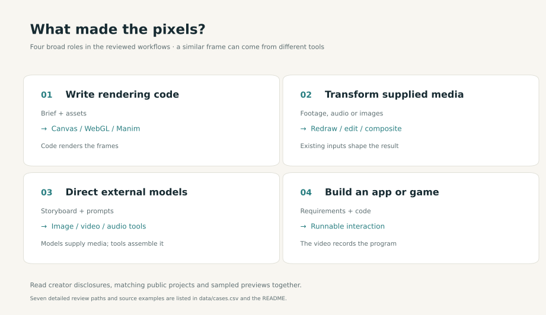
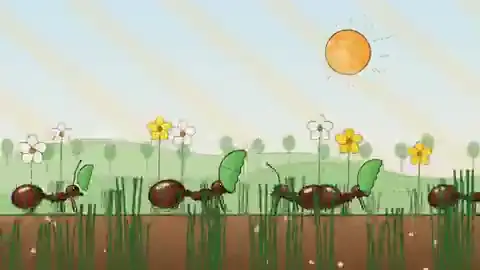
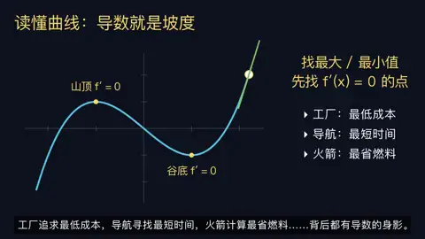
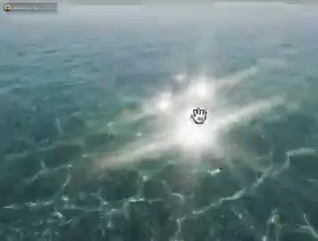
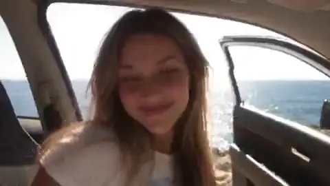
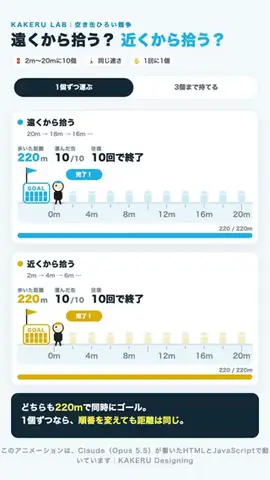
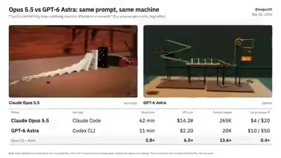
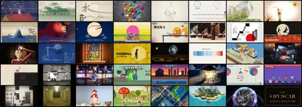

# 制作路径与开源工程

[首页](../README.zh-CN.md) · [English](production-resources.md)

## 七种制作路径，先看画面

每张小图都链接原作者帖子。这七例是有目的地选出的制作路径样本，不是质量排名或各路径的总体比例。[14 条成对证据案例](evidence-examples.zh-CN.md)比较外观相近却输入、工具不同的作品；[168 条案例目录](cases-index.zh-CN.md)则让每条深读案例都有一张可见截图。

| 路径 | 看一个案例 | 需要核对什么 |
|---|---|---|
| 程序二维逐帧绘图 |  [蚂蚁群落与对应源码](https://x.com/hanifproduktif/status/2102742924148830211) | 公开工程的场景、时序、素材是否与成片对应？ |
| 知识讲解 |  [Manim 导数课](https://x.com/LinearUncle/status/2103128559174971663) | 公式、事实、旁白与既有教材是否逐项核对？ |
| 三维与实时图形 |  [Clearwater 与 WebGL 工程](https://x.com/Aurelien_Gz/status/2102786378282987591) | 这是实时程序录屏、三维渲染还是外部视频模型？ |
| 现有素材改编 |  [真人口播线稿重制](https://x.com/AxtonLiu/status/2102827887732932956) | 原表演、音轨或产品文件提供了什么？ |
| 外部视频模型编排 |  [Opus＋Seedance](https://x.com/abxxai/status/2102775755646337530) | Opus 负责分镜调度，还是输出运动画面像素？ |
| 应用与游戏录屏 |  [捡罐模拟器](https://x.com/masaya_1980/status/2103115017755500561) | 交付物是否为可玩的程序，视频只是录屏？ |
| 混合或路径未确定 |  [双模型物理机关对比](https://x.com/leogao25/status/2102544078927741369) | 输入、预算与评价方法是否可比？ |

单看截图无法判断完整制作链。我们区分作者披露、匹配的公开工程或提示词，以及对 X 预览片的独立取样观察。[制作适配指南](visual-effects-fit.zh-CN.md)给出任务与验收建议，这些例子没有构成模型成功率实验。

## 可复用的开源制作工程

| 预览与工程 | 能复用什么，截图展示什么 |
|---|---|
|  [Lemo-Opuscar](https://github.com/lemomo-ai/lemo-opuscar) · [作者原帖](https://x.com/lemomo_ai/status/2103811634565415152) | 官方封面预览[39 种风格图鉴](https://lemomo-ai.github.io/lemo-opuscar/)；每种风格附样片与 `STYLE.md`。[导演指南](https://github.com/lemomo-ai/lemo-opuscar/blob/main/DIRECTOR.md)、[技术指南](https://github.com/lemomo-ai/lemo-opuscar/blob/main/TECHNIQUE.md)和[样片代码](https://github.com/lemomo-ai/lemo-opuscar/blob/main/styles/crayon-book/demo/film.js)公开需求确认、分镜、确定性逐帧渲染、共用时间线与音频检查。作者称用 Canvas／WebGL 绘帧，没有调用视频生成模型；仓库本身无法逐片审计模型调用和成片质量。[许可文件](https://github.com/lemomo-ai/lemo-opuscar/blob/main/LICENSE)将代码列为 MIT，指南、风格说明和影片列为 CC BY 4.0，第三方素材另按各自许可。 |
|  [Papermotion](https://github.com/francozanardi/papermotion) | 可复用的纸片风动画引擎，含确定性物理、角色 rig、离线渲染、帧抓取、contact sheet 和音频检查。截图取自 README 标为 Opus 5.5 的 *snow*；*demo*、*rooftops*、*sea* 也标为 Opus 5.5，*light*、*embers* 则标为 GPT 6 Astra。应按逐片标注理解来源。 |
|  [ClaudeAnimationBase](https://github.com/JohnHeibel/ClaudeAnimationBase) · [作者示例](https://x.com/servasyy/status/2104039075175182487) | 公开的 p5.js／p5.brush 动画底座，提供角色表情、分镜、contact sheet 和渲染流程。截图是 @servasyy 利用该底座制作的个人故事；开源底座是可复用输入，不能代表成片每个镜头的精确源码。 |
|  [Motion Graphics Music Video skill](https://github.com/makevoid/motion-graphics-music-video-skill) · [作者示例](https://x.com/makevoid/status/2103869704955900023) | Claude Code 插件与 Ruby 工具包，根据提供的歌曲和创意要求规划、组装音乐视频动态图形。其 p5.js 流程可调用外部 Fal 图像、视频和音频模型；截图来自多工具制作示例，不代表全部运动画面像素都由 Opus 生成。 |

四个资源于 2026-09-27 核查；后两个作者示例也收录在[新案例证据页](new-cases-2026-09-27.zh-CN.md)。它们都在 9 月 26 日冻结语料之外，**不计入**上面的 1,401 个文件或 168 条深读案例。预览图来源和权利说明见 [THIRD_PARTY.md](../THIRD_PARTY.md)。
