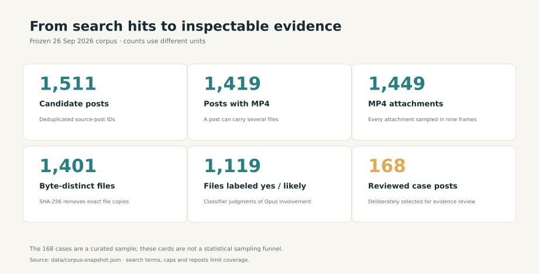
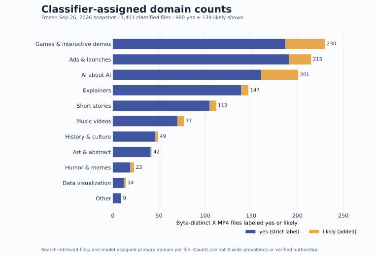
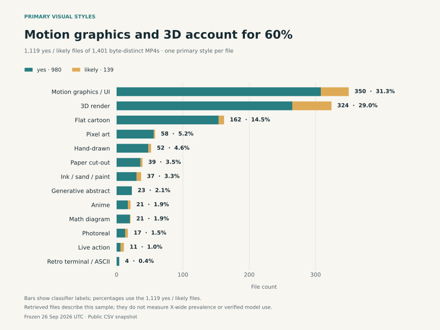
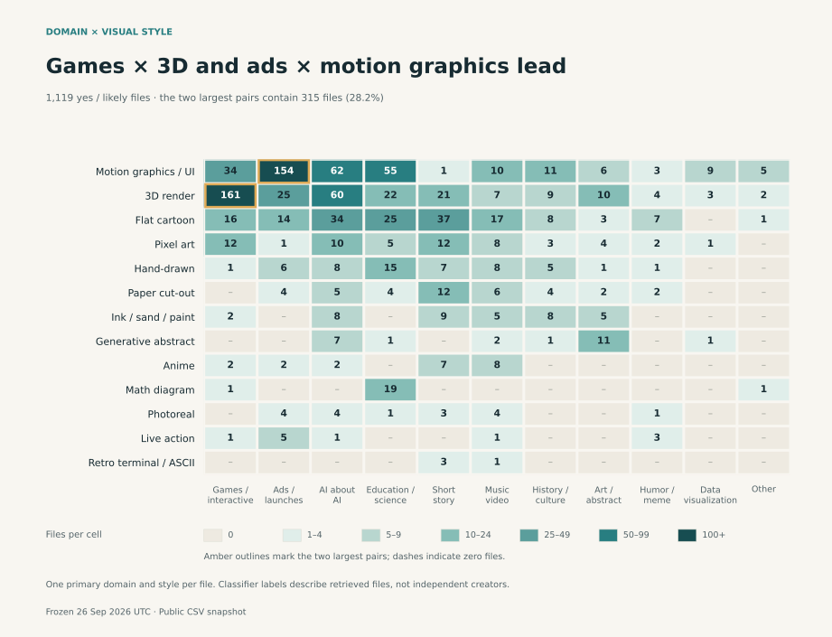
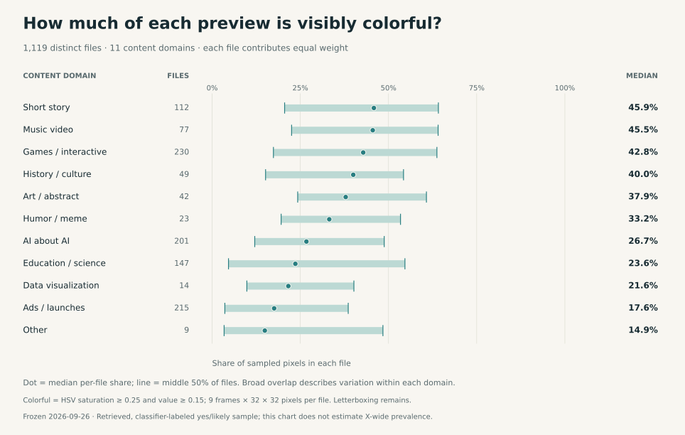
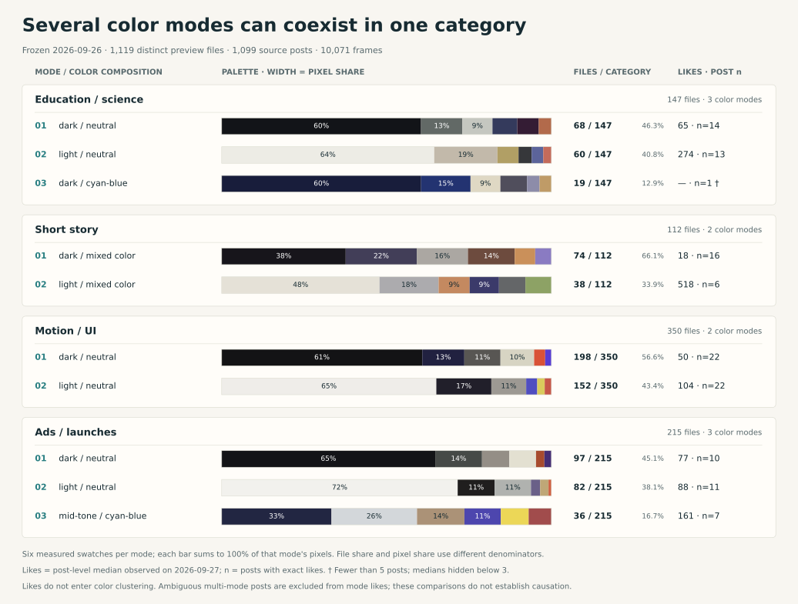
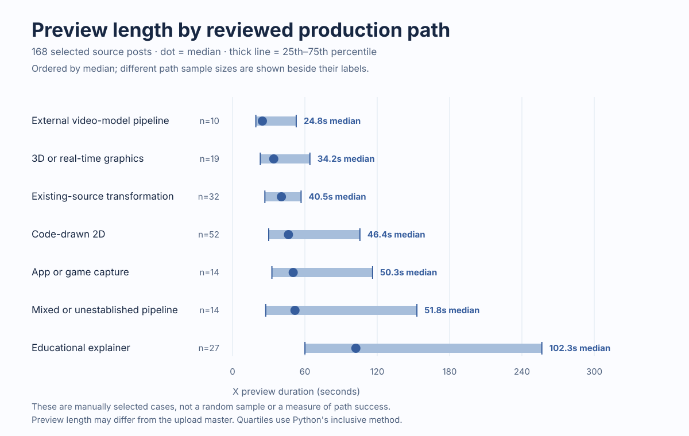
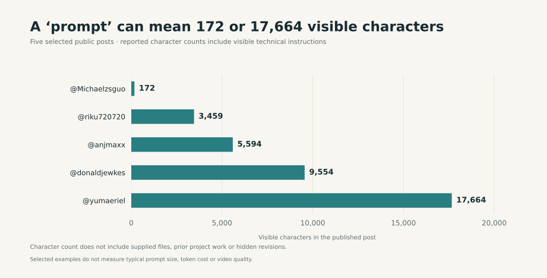

# September 26 snapshot analysis

[Home](../README.md) · [中文](snapshot-analysis.zh-CN.md)

## Frozen snapshot: what each count means

The last successful X search was **September 26, 2026, 21:05 China Standard Time**; the file snapshot was reconciled at 21:53. Of 56 saved queries, 55 succeeded or used cache, while an earlier query was rate-limited. The [coverage notes](search-coverage.zh-CN.md) record the search boundaries. Later additions are kept separate from these frozen counts.

| Count | Counted unit | Public source and boundary |
|---|---|---|
| 1,511 | Deduplicated candidate posts | [Snapshot](../data/corpus-snapshot.json); includes reposts, comparisons, and search noise. |
| 1,419 | Candidate posts with MP4 | [Snapshot](../data/corpus-snapshot.json); a post can contain several files. |
| 1,449 | Retrieved MP4 attachments | [Snapshot](../data/corpus-snapshot.json); all probed and sampled into nine frames with Hypit 0.2.3. |
| 1,401 | Files reported as SHA-256 distinct | [Classifier CSV](../data/domain-style.csv) has one row per file; source hashes and MP4s are private. |
| 1,119 | Files labeled `yes` or `likely` | [Classifier CSV](../data/domain-style.csv); the denominator of the topic, style, and color analyses below. |
| 168 | Deliberately reviewed source-post cases | [Case CSV](../data/cases.csv); chosen to examine production paths and evidence, rather than randomly sampled. |

The 48 byte-identical extra attachments account for **1,449 − 1,401**. Different encodings of the same work can still count as distinct files. These units cannot be read as independent creators, verified Opus runs, or all original videos on X. [Methods and reproducibility](statistics.md#count-the-right-unit) explain which counts can be independently checked from public files.

## Topics and looks in the retrieved sample

Gemini 3.8 Flash classified the post text and nine sampled frames of each of the 1,401 files: **980 `yes`, 139 `likely`, and 282 `no`** for Opus involvement, with one primary domain and one primary style per file. These judgments organize the sample; they do not establish model calls or authorship. The domain, style and color charts in this section use the **1,119 `yes` / `likely` files**. [Data](../data/domain-style.csv) · [classification limits](statistics.md#the-classifier-threshold-changes-first-place).

### Leading domains depend on the threshold

Games / interactive (230), ads / launches (215), and AI about AI (201) account for **646 files, or 57.7%** of the included sample. The top two domains swap places when the inclusion threshold changes:

| Included labels | File denominator | Games / interactive | Ads / launches | First place |
|---|---:|---:|---:|---|
| `yes` | 980 | 187 (19.1%) | 191 (19.5%) | Ads / launches |
| `yes` + `likely` | 1,119 | 230 (20.6%) | 215 (19.2%) | Games / interactive |

The reversal reflects label inclusion, rather than a time trend. Neither threshold gives a bound on actual Opus use.

Motion graphics / UI (350) and 3D render (324) together account for **674 files, or 60.2%**. They also remain the two leading styles with `yes` alone (308 and 265). A video may mix styles; these charts count only its assigned primary style.

### Where domain and style meet

The largest cells are **games × 3D render: 161 (14.4%)**, and **ads × motion graphics / UI: 154 (13.8%)**. Together they contain 315 files, or **28.2%** of the sample. Each included file enters one cell; zero means no included `yes` / `likely` file falls in that cell. The [clickable atlas](domain-style-atlas.md) connects populated cells to pictured cases and original posts; the [full statistical table](statistics.md#domain--primary-style-ten-largest-cells) provides the next largest cells.

Case picks in that atlas use a [separate September 27 engagement refresh](../data/case-engagement-refresh-2026-09-27.csv): **166 of 168 reviewed posts** yielded exact likes and exact post views. Readings span 11:50–12:32 UTC, so they represent different moments. Engagement measures visibility in a selected set of posts; it cannot verify authorship or finished-video quality.

### One category can contain several palettes

The median video-level share of **visibly colorful pixels** is **45.5% for music videos (77 files)** and **17.6% for ads / launches (215 files)**. The measure counts sampled pixels with HSV saturation ≥ 0.25 and value ≥ 0.15; it describes color area, rather than aesthetic quality. See the [per-video measurements](../data/color-study/per-video-color-vectors.csv).

Within-category clustering finds two or three modes in **11 of 13 styles** and **10 of 11 domains**. Motion graphics / UI, for example, splits into **198 dark-neutral** and **152 light-neutral** files. Palette segment widths represent the share of sampled pixels in that mode, rather than its share of videos. The [color study](color-modes.md) provides all 53 modes, full atlases, and measurement rules.

Likes were excluded from clustering. The dark and light motion/UI modes have same-day median likes of **50 and 104**, respectively, with only **22 posts in each mode**. Only **20 of 53 modes** have at least five exact September 27 like observations. Author reach, topic, post age, and distribution confound these comparisons; the study does not test a causal effect of color on likes. [Mode summaries](../data/color-study/color-mode-summary.csv) · [engagement method](color-modes.md#engagement-and-data).

### Preview length also reflects case selection

| Sample and unit | n | Median preview (s) | 25th–75th percentile (s) |
|---|---:|---:|---:|
| All classified files | 1,401 | 39.20 | 21.91–77.07 |
| Reviewed cases' main-post MP4s | 168 | 52.37 | 29.76–117.04 |

The reviewed set has longer previews, but the rows have different units and selection rules. Their difference cannot establish a production-route effect. These durations describe accessible X previews, which may differ from the uploaded masters. [Reproducible duration statistics](statistics.md#preview-duration-distribution).

Educational explainers have the longest median among reviewed paths, **102.28 seconds**; the other six medians range from **24.76 to 51.79 seconds**. The dots mark medians and thick lines span the 25th–75th percentiles. Preview length cannot establish production time, model speed, cost, or path success.

## What a public prompt reveals

Five selected public commissions range from **172 to 17,664 visible characters**. They include technical specifications and a reference-video storyboard, alongside open-ended briefs. Character count measures the text visible in those posts; it does not record all supplied assets, prior turns, revisions, or model cost. These five examples do not describe a prompt-length distribution. [Source-linked counts](../data/visible-prompt-lengths.json) · [88-case prompt/workflow matrix](prompt-matrix.zh-CN.md) · [reusable templates](prompt-playbook.zh-CN.md).

When reusing a brief, carry over its required inputs, rendering route, and checks. Similar public wording also does not establish independent execution: one later music-video commission shares **87.0% of its unique five-word sequences** with an earlier one. The [token-overlap record](../data/prompt-overlap.json) preserves the method and both posts; it cannot establish who read or copied which text.
